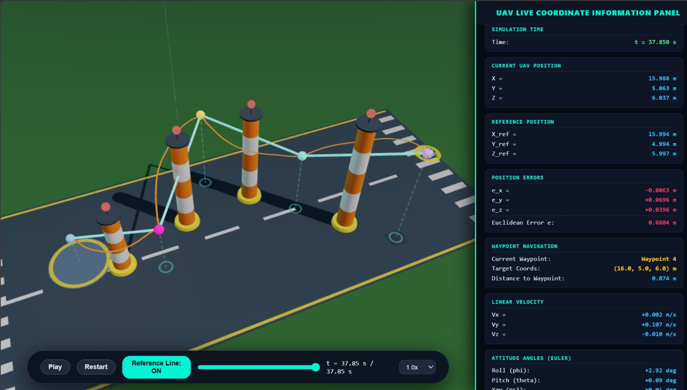
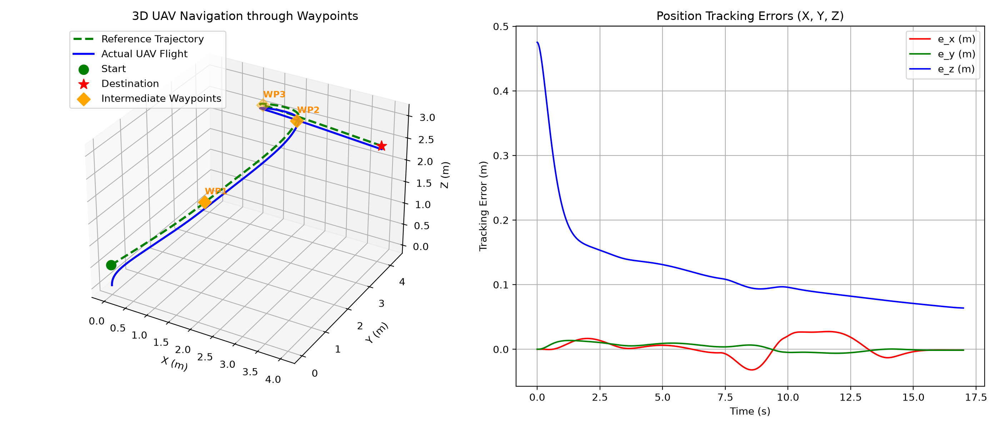
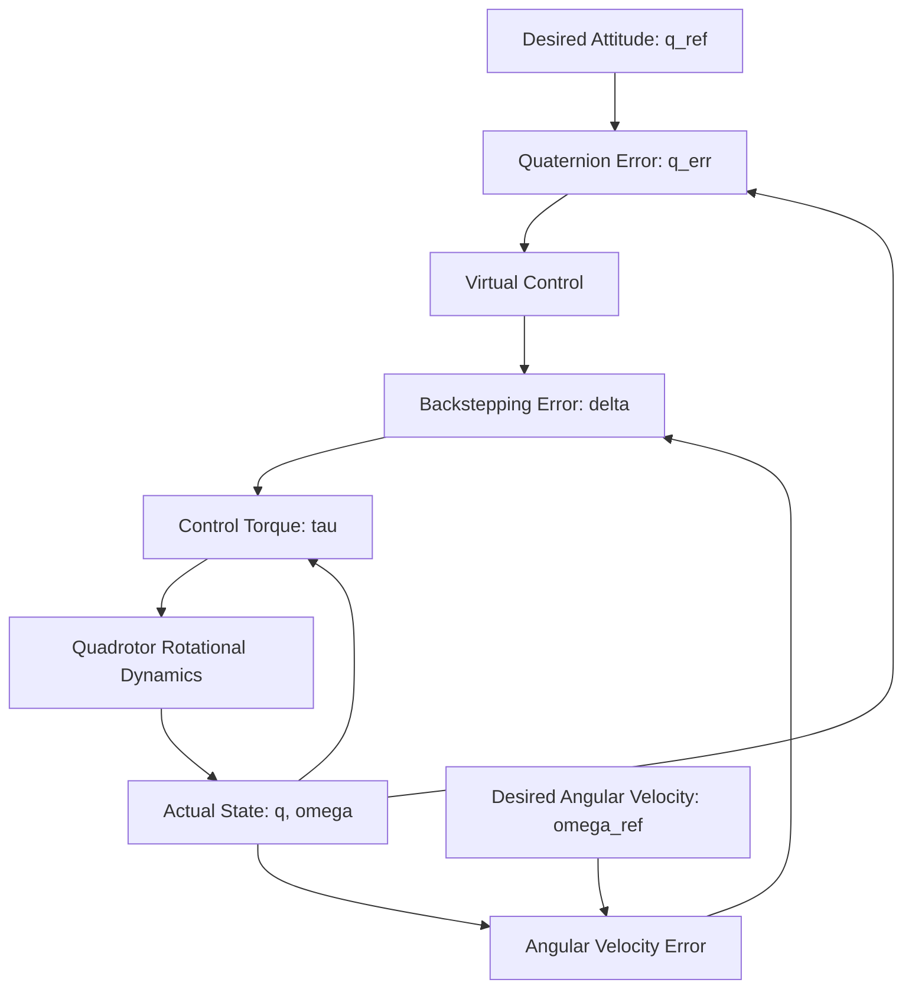

<p align="center">
  
</p>


# Quaternion-Based Attitude Tracking Control for a Quadrotor UAV

## Team Members

| Name | Roll Number |
|---|---|
| N.Supreeth | CB.SC.U4AIE24139 |
| P.Rohit | CB.SC.U4AIE24145 |
| B.Nikhil | CB.SC.U4AIE24063 |
| M.Phanendhra | CB.SC.U4AIE24032 |
| D.Koushik | CB.SC.U4AIE24167 |

---

# Title

## Quaternion-Based Attitude Tracking Control for a Quadrotor UAV

---
## Table of Contents

- [1.Team Members](#team-members)
- [2.Abstract](#abstract)
- [3.Introduction](#introduction)
- [4.Methodology](#methodology)
  - [4.1. Quaternion Representation](#1-quaternion-representation)
  - [4.2. Quaternion Multiplication](#2-quaternion-multiplication)
  - [Equation (8): Quaternion Kinematic Equation](#equation-8-quaternion-kinematic-equation)
  - [Equation (9): Rotational Dynamics of the Quadrotor](#equation-9-rotational-dynamics-of-the-quadrotor)
  - [Equation (10): Quaternion Attitude Error](#equation-10-quaternion-attitude-error)
  - [Equation (11): Angular Velocity Tracking Error](#equation-11-angular-velocity-tracking-error)
  - [Equation (12): Quaternion Error Dynamics](#equation-12-quaternion-error-dynamics)
  - [Equation (13): Virtual Control — Desired Angular Velocity Error](#equation-13-virtual-control--desired-angular-velocity-error)
  - [Equation (14): Desired Quaternion Error Dynamics](#equation-14-desired-quaternion-error-dynamics)
  - [Equation (15): Angular Velocity Error Dynamics](#equation-15-angular-velocity-error-dynamics)
  - [Equation (16): Backstepping Error](#equation-16-backstepping-error)
  - [Equation (17): Quaternion Error Dynamics with Backstepping Error](#equation-17-quaternion-error-dynamics-with-backstepping-error)
  - [Equation (18): Backstepping Error Dynamics](#equation-18-backstepping-error-dynamics)
  - [Equation (19): Backstepping Error Dynamics Including Rotational Dynamics](#equation-19-backstepping-error-dynamics-including-rotational-dynamics)
  - [Equation (20): Derivative of the Virtual Control](#equation-20-derivative-of-the-virtual-control)
  - [Equation (21): Dynamics Compensation Torque](#equation-21-dynamics-compensation-torque)
  - [Equation (22): Fractional-Power Feedback Torque](#equation-22-fractional-power-feedback-torque)
  - [Why Do We Use the Power of One-Third?](#why-do-we-use-the-power-of-one-third)
  - [Equation (23): Final Backstepping Error Dynamics](#equation-23-final-backstepping-error-dynamics)
- [5.Complete Numerical Example of the Backstepping Controller](#complete-numerical-example-of-the-backstepping-controller)
  - [5.1. Given Parameters](#1-given-parameters)
  - [5.2. Calculate the Quaternion Error (Eq. 10)](#2-calculate-the-quaternion-error--equation-10)
  - [5.3. Calculate Desired Angular Velocity Error (Eq. 13)](#3-calculate-the-desired-angular-velocity-error--equation-13)
  - [5.4. Calculate Angular Velocity Tracking Error (Eq. 11)](#4-calculate-the-angular-velocity-tracking-error--equation-11)
  - [5.5. Calculate Backstepping Error (Eq. 16)](#5-calculate-the-backstepping-error--equation-16)
  - [5.6. Calculate Quaternion Error Derivative (Eq. 12)](#6-calculate-the-quaternion-error-derivative--equation-12)
  - [5.7. Calculate Derivative of Virtual Control (Eq. 20)](#7-calculate-the-derivative-of-the-desired-angular-velocity-error--equation-20)
  - [5.8. Calculate Gyroscopic Term (Eq. 9)](#8-calculate-the-gyroscopic-term--equation-9)
  - [5.9. Calculate Compensation Torque (Eq. 21)](#9-calculate-the-compensation-torque--equation-21)
  - [5.10. Calculate One-Third Power of Backstepping Error](#10-calculate-the-one-third-power-of-the-backstepping-error)
  - [5.11. Calculate Feedback Torque (Eq. 22)](#11-calculate-the-feedback-torque--equation-22)
  - [5.12. Calculate Total Control Torque](#12-calculate-the-total-backstepping-control-torque)
  - [5.13. Verify Controller (Eq. 23)](#13-verify-the-controller--equation-23)
  - [5.14. Final Numerical Results](#14-final-numerical-results)
- [6. PyBullet Implementation Details](#10-pybullet-implementation-details)
  - [6.1 Quadrotor Physical Modeling and Dynamics](#101-quadrotor-physical-modeling-and-dynamics)
  - [6.2 Trajectory Planning and Reactive Obstacle Avoidance](#102-trajectory-planning-and-reactive-obstacle-avoidance)
  - [6.3 Real-World Wind and Disturbance Model](#103-real-world-wind-and-disturbance-model)
  - [6.4 Real-Time Telemetry Dashboard (HUD)](#104-real-time-telemetry-dashboard-hud)
- [7. Results](#11-results)
- [8. Supplementary PyBullet 3D Simulation Environment](#12-supplementary-pybullet-3d-simulation-environment)
  - [8.1 Quadrotor Physical Modeling and Rigid-Body Dynamics](#121-quadrotor-physical-modeling-and-rigid-body-dynamics)
  - [8.2 Cascaded 3D Position Control and Trajectory Planning](#122-cascaded-3d-position-control-and-trajectory-planning)
  - [8.3 Real-Time LiDAR Perception and Obstacle Avoidance](#123-real-time-lidar-perception-and-obstacle-avoidance)
  - [8.4 Telemetry, Visualization, and Data Logging](#124-telemetry-visualization-and-data-logging)
  - [8.5 Standalone Benchmark Execution](#125-standalone-benchmark-execution)
  - [8.6 Simulation Results](#126-simulation-results)
- [9. Conclusion](#13-conclusion)
- [10. Controller Workflow](#14-controller-workflow)
- [11. Installation and Environment Setup](#15-installation-and-environment-setup)
  - [11.1 Prerequisites](#151-prerequisites)
  - [11.2 Create a Virtual Environment (Recommended)](#152-create-a-virtual-environment-recommended)
  - [11.3 Install Dependencies](#153-install-dependencies)
- [12. How to Run the PyBullet Simulation](#16-how-to-run-the-pybullet-simulation)
  - [12.1 Overview of Execution Modes](#161-overview-of-execution-modes)
  - [12.2 Command-Line Flags Reference](#162-command-line-flags-reference)
  - [12.3 Practical Command Prompt / Terminal Examples](#163-practical-command-prompt--terminal-examples)
  - [12.4 Standalone Paper Benchmark Execution](#164-standalone-paper-benchmark-execution)
  - [12.5 Interactive Mouse & Camera Controls in PyBullet](#165-interactive-mouse--camera-controls-in-pybullet)
  - [12.6 Automatic Simulation Outputs](#166-automatic-simulation-outputs)
- [13. References](#17-references)
---

# Abstract

Quadrotor UAVs require accurate attitude control to maintain and change their orientation during flight. This project investigates a quaternion-based attitude tracking controller using a backstepping control approach.

Quaternions are used to represent the orientation of the quadrotor because they provide a compact representation of three-dimensional rotations without the singularities associated with Euler angles. The controller uses the difference between the desired and actual quaternion to determine the attitude error and then generates a desired angular velocity through a virtual control law.

A second backstepping stage is used to calculate the required control torque while accounting for the nonlinear rotational dynamics of the quadrotor. A fractional-power feedback term is included to reduce the backstepping error.

The complete controller is implemented and evaluated through numerical simulation in MATLAB. The simulation examines quaternion error, angular velocity tracking error, backstepping error, and control torque.

---

# Introduction

A quadrotor UAV is an underactuated nonlinear system whose motion depends on the interaction between its position, orientation, angular velocity, and control inputs. Among these, attitude control is particularly important because the orientation of the vehicle determines the direction in which the generated thrust acts.

The attitude of a quadrotor can be represented using Euler angles, rotation matrices, or quaternions. Although Euler angles are intuitive, they can suffer from gimbal lock. Quaternions provide an alternative representation that is well suited for describing three-dimensional orientation and nonlinear attitude control.

In this project, the attitude is represented using a unit quaternion:

```math
q = [q_0,\ q_1,\ q_2,\ q_3]^T
```

with the unit-quaternion constraint:

```math
\lVert q\rVert =
\sqrt{q_0^2 + q_1^2 + q_2^2 + q_3^2}
= 1
```

The main objective is to make the actual quadrotor attitude follow a desired attitude trajectory while ensuring that the angular velocity tracking error is reduced.

The control strategy is based on backstepping. Since torque directly affects angular velocity and angular velocity determines the evolution of the attitude, the controller is developed in stages. The first stage generates a desired angular velocity from the quaternion attitude error. The second stage determines the control torque required to make the actual angular velocity follow this desired behaviour.

This project is based on the research paper **"Quaternion-Based Attitude Tracking Control Design for UAVs"** by Qain-Rong Lin and Jen-te Yu, presented at the 2024 International Automatic Control Conference (CACS 2024).

---

# Methodology

## 1. Quaternion Representation

The quadrotor attitude is represented by a unit quaternion:

```math
q = [q_0,\ q_1,\ q_2,\ q_3]^T
```

The quaternion conjugate is given by:

```math
q^* =
[q_0,\ -q_1,\ -q_2,\ -q_3]^T
```

For a unit quaternion, the inverse is equal to its conjugate:

```math
q^{-1} = q^*
```

During numerical simulation, quaternion normalization is applied to maintain the unit-quaternion constraint:

```math
q_{\mathrm{norm}} =
\frac{q}{\lVert q\rVert}
```

---

## 2. Quaternion Multiplication

The multiplication of two quaternions is written as:

```math
q_1 \otimes q_2
```

For:

```math
q_1 = [a,\ b,\ c,\ d]^T
```

and:

```math
q_2 = [e,\ f,\ g,\ h]^T
```

their product is:

```math
q_1 \otimes q_2 =
\begin{bmatrix}
ae-bf-cg-dh \\
af+be+ch-dg \\
ag-bh+ce+df \\
ah+bg-cf+de
\end{bmatrix}
```

Quaternion multiplication is non-commutative:

```math
q_1 \otimes q_2 \neq q_2 \otimes q_1
```

Therefore, the order of multiplication is important when calculating the attitude error.

---


## Equation (8): Quaternion Kinematic Equation

### Equation

The quaternion kinematic equation is:

$$
\boxed{
\dot{q}=\frac{1}{2}q\otimes
\begin{bmatrix}
0\\
\boldsymbol{\omega}
\end{bmatrix}
}
$$

where:

- $q=[q_0,q_1,q_2,q_3]^T$ is the current attitude quaternion.
- $\dot{q}$ is the rate of change of the attitude quaternion.
- $\boldsymbol{\omega}=[\omega_x,\omega_y,\omega_z]^T$ is the angular velocity.
- $\otimes$ represents quaternion multiplication.

### Derivation of Equation (8)

**Step 1: Start with the quaternion representation of rotation.**

A rotation through an angle $\theta$ about a unit axis $\mathbf{u}$ is represented by:

$$
q=
\begin{bmatrix}
\cos(\theta/2)\\
\mathbf{u}\sin(\theta/2)
\end{bmatrix}
$$

The angle is divided by two because quaternions represent a three-dimensional rotation using the half-angle.

**Step 2: Relate angular velocity to the change in angle.**

Angular velocity describes how quickly the rotation angle changes:

$$
\boldsymbol{\omega}=\dot{\theta}\mathbf{u}
$$

Over a small time interval $\Delta t$, the small rotation is approximately:

$$
\Delta\boldsymbol{\theta}
\approx\boldsymbol{\omega}\Delta t
$$

The quaternion representing this small rotation is:

$$
\Delta q=
\begin{bmatrix}
\cos(\Delta\theta/2)\\
\mathbf{u}\sin(\Delta\theta/2)
\end{bmatrix}
$$

For a small angle, we use the approximations:

$$
\cos x\approx1,\qquad \sin x\approx x
$$

Therefore:

$$
\Delta q\approx
\begin{bmatrix}
1\\
\frac{1}{2}\boldsymbol{\omega}\Delta t
\end{bmatrix}
$$

**Step 3: Update the current quaternion.**

Using the multiplication convention in the research paper, the updated quaternion is:

$$
q(t+\Delta t)\approx q(t)\otimes\Delta q
$$

Substituting the small-rotation quaternion:

$$
q(t+\Delta t)\approx
q(t)\otimes
\begin{bmatrix}
1\\
\frac{1}{2}\boldsymbol{\omega}\Delta t
\end{bmatrix}
$$

Using the identity quaternion $[1,0,0,0]^T$ and the linearity of quaternion multiplication, we obtain:

$$
q(t+\Delta t)\approx
q(t)+\frac{\Delta t}{2}
q(t)\otimes
\begin{bmatrix}
0\\
\boldsymbol{\omega}
\end{bmatrix}
$$

**Step 4: Calculate the derivative.**

Subtract $q(t)$ from both sides:

$$
q(t+\Delta t)-q(t)\approx
\frac{\Delta t}{2}
q(t)\otimes
\begin{bmatrix}
0\\
\boldsymbol{\omega}
\end{bmatrix}
$$

Divide both sides by $\Delta t$:

$$
\frac{q(t+\Delta t)-q(t)}{\Delta t}
\approx
\frac{1}{2}
q(t)\otimes
\begin{bmatrix}
0\\
\boldsymbol{\omega}
\end{bmatrix}
$$

As $\Delta t\rightarrow0$, the left-hand side becomes the time derivative of the quaternion:

$$
\dot q=\lim_{\Delta t\rightarrow0}
\frac{q(t+\Delta t)-q(t)}{\Delta t}
$$

Therefore, we obtain Equation (8):

$$
\boxed{
\dot{q}=\frac{1}{2}q\otimes
\begin{bmatrix}
0\\
\boldsymbol{\omega}
\end{bmatrix}
}
$$

The factor $\frac{1}{2}$ comes from the half-angle used in the quaternion representation.

### What Does Equation (8) Do?

Equation (8) calculates how the drone's orientation changes with time based on its current attitude quaternion and angular velocity.

The quaternion $q$ represents the current orientation, while $\boldsymbol{\omega}$ describes the rotational motion. Combining them gives $\dot q$, which tells us how quickly the orientation quaternion is changing.

In the simulation, this equation is integrated over time to continuously update the drone's orientation as it rotates.

**Why Do We Use This Equation in Our Project?**

Our controller must make the actual drone orientation follow a desired orientation. Equation (8) provides the relationship needed to update the actual orientation and evaluate its change during the simulation.

In summary:

- **Quaternion:** Represents the drone's current orientation.
- **Angular velocity:** Describes how quickly the drone rotates.
- **Quaternion derivative:** Describes how quickly the orientation changes.

Equation (8) is the **kinematic model** of the drone's attitude. The next equation, Equation (9), describes the rotational dynamics connecting applied torque to angular acceleration.


## Equation (9): Rotational Dynamics of the Quadrotor

### Equation

The rotational dynamics of the quadrotor are described by:

```math
\boxed{
\dot{\boldsymbol{\omega}}
=
J^{-1}
\left[
\boldsymbol{\tau}
-
\boldsymbol{\omega}\times(J\boldsymbol{\omega})
\right]
}
```

### Meaning of the Variables

- Moment of inertia matrix:

```math
J
```

- Angular velocity vector:

```math
\boldsymbol{\omega}
=
\begin{bmatrix}
\omega_x\\
\omega_y\\
\omega_z
\end{bmatrix}
```

- Angular acceleration vector:

```math
\dot{\boldsymbol{\omega}}
=
\begin{bmatrix}
\dot{\omega}_x\\
\dot{\omega}_y\\
\dot{\omega}_z
\end{bmatrix}
```

- Applied control torque:

```math
\boldsymbol{\tau}
=
\begin{bmatrix}
\tau_x\\
\tau_y\\
\tau_z
\end{bmatrix}
```

- Angular momentum in body coordinates:

```math
\mathbf{H}=J\boldsymbol{\omega}
```

- Gyroscopic coupling term:

```math
\boldsymbol{\omega}\times(J\boldsymbol{\omega})
```

### Derivation of Equation (9)

**Step 1: Start with Euler's equation of rotational motion.**

The applied torque equals the rate of change of angular momentum measured in the inertial reference frame.

```math
\boldsymbol{\tau}
=
\left(\frac{d\mathbf{H}}{dt}\right)_{\mathrm{inertial}}
```

**Step 2: Express angular momentum using angular velocity.**

For a rigid body:

```math
\mathbf{H}=J\boldsymbol{\omega}
```

Substituting into Euler's equation gives:

```math
\boldsymbol{\tau}
=
\left(
\frac{d(J\boldsymbol{\omega})}{dt}
\right)_{\mathrm{inertial}}
```

**Step 3: Account for the rotating body coordinate system.**

The relationship between the inertial derivative and the derivative measured in body coordinates is:

```math
\left(\frac{d\mathbf{H}}{dt}\right)_{\mathrm{inertial}}
=
\left(\frac{d\mathbf{H}}{dt}\right)_{\mathrm{body}}
+
\boldsymbol{\omega}\times\mathbf{H}
```

Substituting angular momentum:

```math
\boldsymbol{\tau}
=
\left(
\frac{d(J\boldsymbol{\omega})}{dt}
\right)_{\mathrm{body}}
+
\boldsymbol{\omega}\times(J\boldsymbol{\omega})
```

**Step 4: Differentiate angular momentum.**

Assuming the inertia matrix is constant in body coordinates:

```math
\left(
\frac{d(J\boldsymbol{\omega})}{dt}
\right)_{\mathrm{body}}
=
J\dot{\boldsymbol{\omega}}
```

Substituting this result:

```math
\boldsymbol{\tau}
=
J\dot{\boldsymbol{\omega}}
+
\boldsymbol{\omega}\times(J\boldsymbol{\omega})
```

**Step 5: Rearrange to obtain angular acceleration.**

Move the gyroscopic term to the other side:

```math
J\dot{\boldsymbol{\omega}}
=
\boldsymbol{\tau}
-
\boldsymbol{\omega}\times(J\boldsymbol{\omega})
```

Multiply both sides by the inverse inertia matrix:

```math
J^{-1}J\dot{\boldsymbol{\omega}}
=
J^{-1}
\left[
\boldsymbol{\tau}
-
\boldsymbol{\omega}\times(J\boldsymbol{\omega})
\right]
```

Since the inverse inertia matrix multiplied by the inertia matrix gives the identity matrix:

```math
J^{-1}J=I
```

The final equation becomes:

```math
\boxed{
\dot{\boldsymbol{\omega}}
=
J^{-1}
\left[
\boldsymbol{\tau}
-
\boldsymbol{\omega}\times(J\boldsymbol{\omega})
\right]
}
```

This is Equation (9).

### What Does Equation (9) Do?

Equation (9) calculates the angular acceleration of the quadrotor based on the applied torque, its rotational inertia, and the coupling between its rotational axes.

**Control torque:** Produces rotational acceleration.

**Moment of inertia:** Determines how strongly the quadrotor resists angular acceleration.

**Gyroscopic coupling:** Accounts for the interaction between angular velocity and angular momentum.

**Angular acceleration:** Describes how angular velocity changes over time.

### Why Do We Use This Equation in Our Project?

The backstepping controller must calculate the torque required to make the quadrotor follow its desired angular velocity and attitude.

Equation (9) provides the mathematical relationship between the control torque and angular acceleration. The controller uses this relationship to compensate for the nonlinear rotational dynamics and determine the required torque.

Equation (8) describes how angular velocity changes the orientation, whereas Equation (9) describes how torque changes angular velocity.


## Equation (10): Quaternion Attitude Error

### Equation

The quaternion attitude error is defined as:

```math
\boxed{
q_{\mathrm{err}}
=
q_{\mathrm{ref}}^*\otimes q
}
```

### Meaning of the Variables

The actual attitude quaternion is:

```math
q=
\begin{bmatrix}
q_0\\
q_1\\
q_2\\
q_3
\end{bmatrix}
```

The desired attitude quaternion is:

```math
q_{\mathrm{ref}}=
\begin{bmatrix}
q_{\mathrm{ref},0}\\
q_{\mathrm{ref},1}\\
q_{\mathrm{ref},2}\\
q_{\mathrm{ref},3}
\end{bmatrix}
```

The conjugate of the reference quaternion is:

```math
q_{\mathrm{ref}}^*=
\begin{bmatrix}
q_{\mathrm{ref},0}\\
-q_{\mathrm{ref},1}\\
-q_{\mathrm{ref},2}\\
-q_{\mathrm{ref},3}
\end{bmatrix}
```

The symbol for quaternion multiplication is:

```math
\otimes
```

### Derivation of Equation (10)

**Step 1: Identify the actual and desired orientations.**

The quadrotor has an actual orientation represented by the quaternion:

```math
q
```

The controller also receives the desired orientation, represented by:

```math
q_{\mathrm{ref}}
```

Our objective is to determine the relative rotation between these two orientations.

**Step 2: Find the inverse of the desired quaternion.**

To calculate the relative orientation, we first need to reverse the desired rotation.

For a unit quaternion, the inverse equals its conjugate:

```math
q_{\mathrm{ref}}^{-1}=q_{\mathrm{ref}}^*
```

The conjugate is obtained by keeping the scalar component unchanged and reversing the signs of the three vector components.

**Step 3: Calculate the relative orientation.**

Quaternion multiplication allows us to combine rotations.

To express the actual orientation relative to the desired orientation, we multiply the inverse of the reference quaternion by the actual quaternion:

```math
q_{\mathrm{err}}
=
q_{\mathrm{ref}}^{-1}\otimes q
```

Since the reference quaternion is a unit quaternion:

```math
q_{\mathrm{ref}}^{-1}=q_{\mathrm{ref}}^*
```

Substituting this into the equation gives:

```math
q_{\mathrm{err}}
=
q_{\mathrm{ref}}^*\otimes q
```

Therefore, Equation (10) is:

```math
\boxed{
q_{\mathrm{err}}
=
q_{\mathrm{ref}}^*\otimes q
}
```

### Verification: What Happens When There Is No Attitude Error?

Suppose the actual attitude exactly matches the desired attitude:

```math
q=q_{\mathrm{ref}}
```

Substituting this into Equation (10):

```math
q_{\mathrm{err}}
=
q_{\mathrm{ref}}^*\otimes q_{\mathrm{ref}}
```

For a unit quaternion, multiplying its conjugate by itself produces the identity quaternion:

```math
q_{\mathrm{ref}}^*\otimes q_{\mathrm{ref}}
=
\begin{bmatrix}
1\\
0\\
0\\
0
\end{bmatrix}
```

Therefore:

```math
\boxed{
q_{\mathrm{err}}
=
\begin{bmatrix}
1\\
0\\
0\\
0
\end{bmatrix}
}
```

This confirms that the quaternion error becomes the identity quaternion when the actual and desired orientations are identical.

### What Does Equation (10) Do?

Equation (10) calculates the relative orientation between the actual quadrotor attitude and the desired attitude.

The controller uses this error to determine how the drone must rotate to reach its target orientation.

For example, if the desired orientation is different from the actual orientation, the error quaternion represents the relative rotation needed to describe that mismatch.

When the error quaternion approaches the identity quaternion, the actual and desired orientations align.

### Why Do We Use This Equation in Our Project?

Our quaternion-based backstepping controller needs a mathematical measure of the difference between the actual and desired orientations.

Equation (10) provides that measure. The controller uses the quaternion error to generate the desired angular-velocity correction in the next stage.

In summary:

- The reference quaternion represents the desired orientation.
- The actual quaternion represents the current orientation.
- The quaternion error represents their relative orientation.
- The identity quaternion indicates that the two orientations are aligned.

The next equation defines the angular-velocity tracking error, which measures the difference between the actual and desired rotational velocities.


## Equation (11): Angular Velocity Tracking Error

### Equation

The angular velocity tracking error is defined as:

```math
\boxed{
\boldsymbol{\omega}_{\mathrm{err}}
=
\boldsymbol{\omega}
-
\boldsymbol{\omega}_{\mathrm{ref}}
}
```

### Meaning of the Variables

The actual angular velocity is:

```math
\boldsymbol{\omega}
=
\begin{bmatrix}
\omega_x\\
\omega_y\\
\omega_z
\end{bmatrix}
```

The desired angular velocity is:

```math
\boldsymbol{\omega}_{\mathrm{ref}}
=
\begin{bmatrix}
\omega_{\mathrm{ref},x}\\
\omega_{\mathrm{ref},y}\\
\omega_{\mathrm{ref},z}
\end{bmatrix}
```

The angular velocity tracking error is:

```math
\boldsymbol{\omega}_{\mathrm{err}}
=
\begin{bmatrix}
\omega_{\mathrm{err},x}\\
\omega_{\mathrm{err},y}\\
\omega_{\mathrm{err},z}
\end{bmatrix}
```

### Derivation of Equation (11)

**Step 1: Identify the actual angular velocity.**

The actual angular velocity represents how quickly the quadrotor rotates about its three body axes.

```math
\boldsymbol{\omega}
=
\begin{bmatrix}
\omega_x\\
\omega_y\\
\omega_z
\end{bmatrix}
```

**Step 2: Identify the desired angular velocity.**

The reference trajectory specifies the angular velocity that the quadrotor should achieve.

```math
\boldsymbol{\omega}_{\mathrm{ref}}
=
\begin{bmatrix}
\omega_{\mathrm{ref},x}\\
\omega_{\mathrm{ref},y}\\
\omega_{\mathrm{ref},z}
\end{bmatrix}
```

**Step 3: Calculate the difference between the actual and desired values.**

Tracking error is defined as the actual value minus the desired value.

Therefore:

```math
\boldsymbol{\omega}_{\mathrm{err}}
=
\boldsymbol{\omega}
-
\boldsymbol{\omega}_{\mathrm{ref}}
```

Substituting the component vectors:

```math
\boldsymbol{\omega}_{\mathrm{err}}
=
\begin{bmatrix}
\omega_x\\
\omega_y\\
\omega_z
\end{bmatrix}
-
\begin{bmatrix}
\omega_{\mathrm{ref},x}\\
\omega_{\mathrm{ref},y}\\
\omega_{\mathrm{ref},z}
\end{bmatrix}
```

Subtracting the vectors component by component gives:

```math
\boldsymbol{\omega}_{\mathrm{err}}
=
\begin{bmatrix}
\omega_x-\omega_{\mathrm{ref},x}\\
\omega_y-\omega_{\mathrm{ref},y}\\
\omega_z-\omega_{\mathrm{ref},z}
\end{bmatrix}
```

Hence, Equation (11) is:

```math
\boxed{
\boldsymbol{\omega}_{\mathrm{err}}
=
\boldsymbol{\omega}
-
\boldsymbol{\omega}_{\mathrm{ref}}
}
```

### Example

Suppose the actual angular velocity is:

```math
\boldsymbol{\omega}
=
\begin{bmatrix}
2\\
1\\
3
\end{bmatrix}
```

and the desired angular velocity is:

```math
\boldsymbol{\omega}_{\mathrm{ref}}
=
\begin{bmatrix}
1\\
0.5\\
2
\end{bmatrix}
```

The angular velocity tracking error is:

```math
\boldsymbol{\omega}_{\mathrm{err}}
=
\begin{bmatrix}
2\\
1\\
3
\end{bmatrix}
-
\begin{bmatrix}
1\\
0.5\\
2
\end{bmatrix}
```

Therefore:

```math
\boxed{
\boldsymbol{\omega}_{\mathrm{err}}
=
\begin{bmatrix}
1\\
0.5\\
1
\end{bmatrix}
}
```

The positive values indicate that the actual angular velocity is greater than the desired angular velocity along all three axes in this example.

### What Does Equation (11) Do?

Equation (11) measures the difference between the actual rotational motion of the quadrotor and its desired rotational motion.

If the actual angular velocity is greater than the desired value along an axis, the error along that axis is positive. If it is smaller, the error is negative.

When the actual and desired angular velocities match:

```math
\boldsymbol{\omega}
=
\boldsymbol{\omega}_{\mathrm{ref}}
```

their difference becomes:

```math
\boxed{
\boldsymbol{\omega}_{\mathrm{err}}
=
\begin{bmatrix}
0\\
0\\
0
\end{bmatrix}
}
```

This is the desired angular velocity tracking condition.

### Why Do We Use This Equation in Our Project?

Our controller must track both the desired orientation and the desired rotational motion.

Equation (10) measures the attitude difference using quaternion error, while Equation (11) measures the angular velocity difference.

The angular velocity error is then used to derive the quaternion error dynamics and design the backstepping controller.

In summary, Equation (10) tells us how the orientations differ, whereas Equation (11) tells us how the rotational velocities differ.


## Equation (12): Quaternion Error Dynamics

### Equation

The quaternion error dynamics are given by:

```math
\boxed{
\dot{q}_{\mathrm{err}}
=
\frac{1}{2}
q_{\mathrm{err}}\otimes
\begin{bmatrix}
0\\
\boldsymbol{\omega}_{\mathrm{err}}
\end{bmatrix}
}
```

### Meaning of the Variables

The quaternion attitude error is:

```math
q_{\mathrm{err}}
=
q_{\mathrm{ref}}^*\otimes q
```

The angular velocity error is:

```math
\boldsymbol{\omega}_{\mathrm{err}}
=
\boldsymbol{\omega}
-
\boldsymbol{\omega}_{\mathrm{ref}}
```

The rate of change of the quaternion error is:

```math
\dot{q}_{\mathrm{err}}
```

### Derivation of Equation (12)

**Step 1: Start with the quaternion kinematic equation.**

From Equation (8), the actual quaternion dynamics are:

```math
\dot{q}
=
\frac{1}{2}
q\otimes
\begin{bmatrix}
0\\
\boldsymbol{\omega}
\end{bmatrix}
```

This equation describes how the actual orientation changes with angular velocity.

**Step 2: Define the quaternion attitude error.**

From Equation (10), the attitude error is:

```math
q_{\mathrm{err}}
=
q_{\mathrm{ref}}^*\otimes q
```

This represents the relative orientation between the desired and actual attitudes.

**Step 3: Define the angular velocity error.**

From Equation (11), the angular velocity error is:

```math
\boldsymbol{\omega}_{\mathrm{err}}
=
\boldsymbol{\omega}
-
\boldsymbol{\omega}_{\mathrm{ref}}
```

Rearranging:

```math
\boldsymbol{\omega}
=
\boldsymbol{\omega}_{\mathrm{err}}
+
\boldsymbol{\omega}_{\mathrm{ref}}
```

This expresses the actual angular velocity as the desired reference angular velocity plus the angular velocity tracking error.

**Step 4: Differentiate the quaternion error.**

Starting from Equation (10):

```math
q_{\mathrm{err}}
=
q_{\mathrm{ref}}^*\otimes q
```

Apply the product rule for quaternion multiplication:

```math
\dot{q}_{\mathrm{err}}
=
\dot{q}_{\mathrm{ref}}^*\otimes q
+
q_{\mathrm{ref}}^*\otimes\dot{q}
```

This is the general derivative of the defined quaternion error.

**Step 5: Express the error dynamics using the angular velocity error.**

Under the relative angular-velocity convention adopted by the research paper, the quaternion error dynamics are expressed as:

```math
\boxed{
\dot{q}_{\mathrm{err}}
=
\frac{1}{2}
q_{\mathrm{err}}\otimes
\begin{bmatrix}
0\\
\boldsymbol{\omega}_{\mathrm{err}}
\end{bmatrix}
}
```

This is Equation (12) as presented in the paper.

**Mathematical note:** The final step uses the paper's adopted relative-motion convention. In a general derivation using body-frame angular velocities, the product-rule expression does not automatically reduce to this equation; the relative angular velocity and reference-frame conventions must be consistent.

### What Does Equation (12) Do?

Equation (12) describes how the attitude error changes over time.

The quaternion error indicates the difference between the actual and desired orientations, while the angular velocity error determines how the relative attitude evolves under the adopted error model.

When the angular velocity error approaches zero, the relative quaternion becomes stationary under this equation. To ensure the attitude error converges to the identity quaternion, the controller must also be designed to drive the attitude error toward its target.

### Why Do We Use This Equation in Our Project?

Equation (12) establishes the relationship needed to design the first stage of the backstepping controller.

The controller uses the quaternion error to calculate a desired angular velocity error. This becomes the virtual control used in the next equation.

In summary:

- Equation (10) calculates the quaternion attitude error.
- Equation (11) calculates the angular velocity tracking error.
- Equation (12) describes the evolution of the quaternion error under the paper's adopted error model.

Equation (12) is the starting point for designing the virtual control in Equation (13).


## Equation (13): Virtual Control — Desired Angular Velocity Error

### Equation

The virtual control is defined as:

```math
\boxed{
\begin{bmatrix}
0\\
\boldsymbol{\omega}_{\mathrm{err},d}
\end{bmatrix}
=
-k_1 q_{\mathrm{err}}^*
\otimes
(q_{\mathrm{err}}-q_i)
}
```

where the identity quaternion is:

```math
q_i=
\begin{bmatrix}
1\\
0\\
0\\
0
\end{bmatrix}
```

The first control gain must satisfy:

```math
k_1>0
```

### Derivation of Equation (13)

**Step 1: Start with Equation (12).**

The quaternion error dynamics are:

```math
\dot q_{\mathrm{err}}
=
\frac{1}{2}
q_{\mathrm{err}}\otimes
\begin{bmatrix}
0\\
\boldsymbol{\omega}_{\mathrm{err}}
\end{bmatrix}
```

This equation shows that the attitude error changes according to the angular velocity error.

Our objective is to make the quaternion error approach the identity quaternion.

**Step 2: Choose the desired error convergence behaviour.**

We want the quaternion error to move toward the identity quaternion:

```math
q_{\mathrm{err}}\rightarrow q_i
```

The paper selects the following desired error dynamics:

```math
\dot q_{\mathrm{err}}
=
-\frac{k_1}{2}(q_{\mathrm{err}}-q_i)
```

The negative sign makes the feedback act in the direction that reduces the error under the intended control law.

**Step 3: Assume the actual angular velocity error follows the desired virtual control.**

At the ideal first backstepping stage:

```math
\boldsymbol{\omega}_{\mathrm{err}}
=
\boldsymbol{\omega}_{\mathrm{err},d}
```

Substituting this into Equation (12):

```math
\dot q_{\mathrm{err}}
=
\frac{1}{2}
q_{\mathrm{err}}\otimes
\begin{bmatrix}
0\\
\boldsymbol{\omega}_{\mathrm{err},d}
\end{bmatrix}
```

**Step 4: Solve for the desired angular velocity error.**

Using the desired error dynamics:

```math
-\frac{k_1}{2}(q_{\mathrm{err}}-q_i)
=
\frac{1}{2}
q_{\mathrm{err}}\otimes
\begin{bmatrix}
0\\
\boldsymbol{\omega}_{\mathrm{err},d}
\end{bmatrix}
```

Multiply both sides by two:

```math
-k_1(q_{\mathrm{err}}-q_i)
=
q_{\mathrm{err}}\otimes
\begin{bmatrix}
0\\
\boldsymbol{\omega}_{\mathrm{err},d}
\end{bmatrix}
```

Multiply on the left by the conjugate quaternion:

```math
-k_1q_{\mathrm{err}}^*
\otimes(q_{\mathrm{err}}-q_i)
=
q_{\mathrm{err}}^*\otimes q_{\mathrm{err}}
\otimes
\begin{bmatrix}
0\\
\boldsymbol{\omega}_{\mathrm{err},d}
\end{bmatrix}
```

For a unit quaternion:

```math
q_{\mathrm{err}}^*\otimes q_{\mathrm{err}}=q_i
```

Therefore, the intended virtual-control expression is:

```math
\begin{bmatrix}
0\\
\boldsymbol{\omega}_{\mathrm{err},d}
\end{bmatrix}
=
-k_1q_{\mathrm{err}}^*
\otimes(q_{\mathrm{err}}-q_i)
```

This is Equation (13) as presented in the paper.

**Mathematical clarification:** Because angular velocity is a three-dimensional vector, the right-hand side must be interpreted using its vector part. If the error quaternion is written as:

```math
q_{\mathrm{err}}
=
\begin{bmatrix}
\eta\\
\boldsymbol{\epsilon}
\end{bmatrix}
```

then the vector-part result is:

```math
\boxed{
\boldsymbol{\omega}_{\mathrm{err},d}
=
-k_1\boldsymbol{\epsilon}
}
```

This is the corresponding virtual angular-velocity command for the vector-part implementation.

### What Does Equation (13) Do?

Equation (13) converts the quaternion attitude error into a desired angular velocity error.

The controller uses this virtual control to determine the rotational correction required to reduce the attitude mismatch.

The gain controls the strength of this correction:

```math
k_1>0
```

A larger gain increases the corrective command for a given error, although excessively large gains may cause numerical or actuator-related problems in an implementation.

### Why Do We Use Equation (13)?

The actual attitude cannot be corrected directly by applying an orientation value as torque. Instead, the controller first calculates a desired angular velocity correction and then uses the torque controller to make the drone follow that correction.

Equation (13) therefore forms the first stage of the backstepping controller.

---

## Equation (14): Desired Quaternion Error Dynamics

### Equation

The paper gives the desired quaternion error dynamics as:

```math
\boxed{
\dot q_{\mathrm{err}}
=
-\frac{k_1}{2}(q_{\mathrm{err}}-q_i)
}
```

### Derivation of Equation (14)

**Step 1: Start with Equation (12).**

```math
\dot q_{\mathrm{err}}
=
\frac{1}{2}
q_{\mathrm{err}}\otimes
\begin{bmatrix}
0\\
\boldsymbol{\omega}_{\mathrm{err}}
\end{bmatrix}
```

**Step 2: Assume ideal tracking of the virtual control.**

```math
\boldsymbol{\omega}_{\mathrm{err}}
=
\boldsymbol{\omega}_{\mathrm{err},d}
```

Therefore:

```math
\dot q_{\mathrm{err}}
=
\frac{1}{2}
q_{\mathrm{err}}\otimes
\begin{bmatrix}
0\\
\boldsymbol{\omega}_{\mathrm{err},d}
\end{bmatrix}
```

**Step 3: Substitute the intended virtual-control expression from Equation (13).**

```math
\dot q_{\mathrm{err}}
=
-\frac{k_1}{2}
q_{\mathrm{err}}\otimes
q_{\mathrm{err}}^*
\otimes
(q_{\mathrm{err}}-q_i)
```

**Step 4: Use the unit-quaternion identity.**

```math
q_{\mathrm{err}}\otimes q_{\mathrm{err}}^*=q_i
```

Consequently, the paper's intended simplification is:

```math
\dot q_{\mathrm{err}}
=
-\frac{k_1}{2}(q_{\mathrm{err}}-q_i)
```

This is Equation (14) as presented in the paper.

### What Does Equation (14) Do?

The equation specifies the desired behaviour of the quaternion error. Its purpose is to drive the attitude error toward the identity quaternion.

The intended target is:

```math
q_{\mathrm{err}}\rightarrow
\begin{bmatrix}
1\\
0\\
0\\
0
\end{bmatrix}
```

When the error approaches the identity quaternion, the relative orientation between the actual drone and the desired orientation approaches zero rotation.


---

## Equation (15): Angular Velocity Error Dynamics

### Equation

The angular velocity error dynamics are defined as:

```math
\boxed{
\dot{\boldsymbol{\omega}}_{\mathrm{err}}
=
\dot{\boldsymbol{\omega}}
-
\dot{\boldsymbol{\omega}}_{\mathrm{ref}}
}
```

### Meaning of the Variables

The angular velocity error is:

```math
\boldsymbol{\omega}_{\mathrm{err}}
=
\boldsymbol{\omega}
-
\boldsymbol{\omega}_{\mathrm{ref}}
```

The actual angular acceleration is:

```math
\dot{\boldsymbol{\omega}}
```

The reference angular acceleration is:

```math
\dot{\boldsymbol{\omega}}_{\mathrm{ref}}
```

### Derivation of Equation (15)

**Step 1: Start with Equation (11).**

The angular velocity tracking error is:

```math
\boldsymbol{\omega}_{\mathrm{err}}
=
\boldsymbol{\omega}
-
\boldsymbol{\omega}_{\mathrm{ref}}
```

This represents the difference between the actual angular velocity and the desired angular velocity.

**Step 2: Differentiate both sides with respect to time.**

```math
\frac{d\boldsymbol{\omega}_{\mathrm{err}}}{dt}
=
\frac{d}{dt}
\left(
\boldsymbol{\omega}
-
\boldsymbol{\omega}_{\mathrm{ref}}
\right)
```

Using the differentiation rule for the difference of two time-dependent vectors:

```math
\frac{d\boldsymbol{\omega}_{\mathrm{err}}}{dt}
=
\frac{d\boldsymbol{\omega}}{dt}
-
\frac{d\boldsymbol{\omega}_{\mathrm{ref}}}{dt}
```

**Step 3: Express the derivatives as angular accelerations.**

By definition:

```math
\frac{d\boldsymbol{\omega}_{\mathrm{err}}}{dt}
=
\dot{\boldsymbol{\omega}}_{\mathrm{err}}
```

Similarly:

```math
\frac{d\boldsymbol{\omega}}{dt}
=
\dot{\boldsymbol{\omega}}
```

and:

```math
\frac{d\boldsymbol{\omega}_{\mathrm{ref}}}{dt}
=
\dot{\boldsymbol{\omega}}_{\mathrm{ref}}
```

Substituting these definitions gives:

```math
\boxed{
\dot{\boldsymbol{\omega}}_{\mathrm{err}}
=
\dot{\boldsymbol{\omega}}
-
\dot{\boldsymbol{\omega}}_{\mathrm{ref}}
}
```

This is Equation (15).

### What Does Equation (15) Do?

Equation (15) describes how the angular velocity tracking error changes over time.

If the actual angular acceleration is different from the reference angular acceleration, the angular velocity error changes accordingly.

If the two angular accelerations are equal:

```math
\dot{\boldsymbol{\omega}}
=
\dot{\boldsymbol{\omega}}_{\mathrm{ref}}
```

then:

```math
\dot{\boldsymbol{\omega}}_{\mathrm{err}}=0
```

This means the angular velocity error is momentarily constant. It does not necessarily mean the error itself is zero.

### Why Do We Use Equation (15)?

The backstepping controller needs the derivative of angular velocity error to calculate the derivative of its next error variable.

Equation (15) supplies this relationship. In the following controller-design steps, the actual angular acceleration is replaced using Equation (9), allowing the control torque to be determined.

In summary, Equation (13) defines the virtual angular-velocity correction, Equation (14) describes the intended attitude-error convergence behaviour, and Equation (15) provides the derivative needed for the second backstepping stage.


## Equation (16): Backstepping Error

### Equation

The backstepping error is defined as:

```math
\boxed{
\boldsymbol{\delta}
=
\boldsymbol{\omega}_{\mathrm{err}}
-
\boldsymbol{\omega}_{\mathrm{err},d}
}
```

### Meaning of the Variables

The actual angular velocity tracking error is:

```math
\boldsymbol{\omega}_{\mathrm{err}}
```

The desired angular velocity error generated by the virtual controller is:

```math
\boldsymbol{\omega}_{\mathrm{err},d}
```

Their difference is the backstepping error:

```math
\boldsymbol{\delta}
```

### Derivation of Equation (16)

**Step 1: Recall Equation (11).**

The angular velocity tracking error is:

```math
\boldsymbol{\omega}_{\mathrm{err}}
=
\boldsymbol{\omega}
-
\boldsymbol{\omega}_{\mathrm{ref}}
```

This tells us the difference between the actual angular velocity and the reference angular velocity.

**Step 2: Identify the virtual control.**

Equation (13) defines a desired angular velocity error:

```math
\boldsymbol{\omega}_{\mathrm{err},d}
```

This is the angular velocity correction that the first stage of the controller wants the system to follow.

**Step 3: Calculate the difference.**

The backstepping approach defines the difference between the actual error and the desired error as:

```math
\boxed{
\boldsymbol{\delta}
=
\boldsymbol{\omega}_{\mathrm{err}}
-
\boldsymbol{\omega}_{\mathrm{err},d}
}
```

Rearranging gives:

```math
\boxed{
\boldsymbol{\omega}_{\mathrm{err}}
=
\boldsymbol{\omega}_{\mathrm{err},d}
+
\boldsymbol{\delta}
}
```

This is Equation (16).

### What Does Equation (16) Do?

It measures how far the actual angular velocity error is from the desired angular velocity error.

If the backstepping error becomes zero:

```math
\boldsymbol{\delta}=\mathbf{0}
```

then:

```math
\boldsymbol{\omega}_{\mathrm{err}}
=
\boldsymbol{\omega}_{\mathrm{err},d}
```

The actual angular velocity error therefore matches the virtual control.

### Why Do We Use Equation (16)?

The actual attitude cannot be controlled directly by assigning a desired orientation. The controller first calculates the desired angular velocity correction and then generates torque to make the drone follow it.

Equation (16) defines the error that the second stage of backstepping must drive toward zero.

---

## Equation (17): Quaternion Error Dynamics with Backstepping Error

### Equation

The paper expresses the quaternion error dynamics as:

```math
\boxed{
\dot q_{\mathrm{err}}
=
-\frac{k_1}{2}
(q_{\mathrm{err}}-q_i)
+
\frac{1}{2}
q_{\mathrm{err}}\otimes
\begin{bmatrix}
0\\
\boldsymbol{\delta}
\end{bmatrix}
}
```

where:

```math
q_i=
\begin{bmatrix}
1\\
0\\
0\\
0
\end{bmatrix}
```

### Derivation of Equation (17)

**Step 1: Start with Equation (12).**

The quaternion error dynamics are:

```math
\dot q_{\mathrm{err}}
=
\frac{1}{2}
q_{\mathrm{err}}\otimes
\begin{bmatrix}
0\\
\boldsymbol{\omega}_{\mathrm{err}}
\end{bmatrix}
```

**Step 2: Use Equation (16).**

From the backstepping error definition:

```math
\boldsymbol{\delta}
=
\boldsymbol{\omega}_{\mathrm{err}}
-
\boldsymbol{\omega}_{\mathrm{err},d}
```

Rearranging:

```math
\boldsymbol{\omega}_{\mathrm{err}}
=
\boldsymbol{\omega}_{\mathrm{err},d}
+
\boldsymbol{\delta}
```

**Step 3: Substitute into Equation (12).**

```math
\dot q_{\mathrm{err}}
=
\frac{1}{2}
q_{\mathrm{err}}\otimes
\begin{bmatrix}
0\\
\boldsymbol{\omega}_{\mathrm{err},d}
+
\boldsymbol{\delta}
\end{bmatrix}
```

By the linearity of quaternion multiplication in its second operand:

```math
\begin{aligned}
\dot q_{\mathrm{err}}
={}&
\frac{1}{2}
q_{\mathrm{err}}\otimes
\begin{bmatrix}
0\\
\boldsymbol{\omega}_{\mathrm{err},d}
\end{bmatrix}\\
&+
\frac{1}{2}
q_{\mathrm{err}}\otimes
\begin{bmatrix}
0\\
\boldsymbol{\delta}
\end{bmatrix}
\end{aligned}
```

**Step 4: Substitute the virtual-control convergence term.**

The paper intends the first term to provide the desired attitude-error feedback:

```math
-\frac{k_1}{2}(q_{\mathrm{err}}-q_i)
```

Using that intended substitution gives:

```math
\boxed{
\dot q_{\mathrm{err}}
=
-\frac{k_1}{2}
(q_{\mathrm{err}}-q_i)
+
\frac{1}{2}
q_{\mathrm{err}}\otimes
\begin{bmatrix}
0\\
\boldsymbol{\delta}
\end{bmatrix}
}
```

This is Equation (17) as presented by the paper's design approach.

### What Does Equation (17) Do?

It shows that the attitude error depends on two contributions:

1. The desired corrective feedback, intended to reduce the quaternion error.
2. The remaining backstepping error, which represents the mismatch between actual and desired angular velocity errors.

When the backstepping error approaches zero, the second contribution disappears from this equation.

### Why Do We Use Equation (17)?

It connects the first backstepping stage to the second. It allows the controller design to account for the fact that the physical angular velocity may not instantly follow the virtual control.

**Mathematical clarification:** The paper's simplification of the full quaternion feedback is not an exact identity for a general unit quaternion when angular velocity is restricted to three components. In a strictly consistent implementation, the vector-part virtual control and quaternion kinematics must be used together.

---

## Equation (18): Backstepping Error Dynamics

### Equation

The derivative of the backstepping error is:

```math
\boxed{
\dot{\boldsymbol{\delta}}
=
\dot{\boldsymbol{\omega}}_{\mathrm{err}}
-
\dot{\boldsymbol{\omega}}_{\mathrm{err},d}
}
```

### Derivation of Equation (18)

**Step 1: Start with Equation (16).**

```math
\boldsymbol{\delta}
=
\boldsymbol{\omega}_{\mathrm{err}}
-
\boldsymbol{\omega}_{\mathrm{err},d}
```

**Step 2: Differentiate both sides with respect to time.**

```math
\frac{d\boldsymbol{\delta}}{dt}
=
\frac{d}{dt}
\left(
\boldsymbol{\omega}_{\mathrm{err}}
-
\boldsymbol{\omega}_{\mathrm{err},d}
\right)
```

Using the differentiation rule for the difference of two vectors:

```math
\frac{d\boldsymbol{\delta}}{dt}
=
\frac{d\boldsymbol{\omega}_{\mathrm{err}}}{dt}
-
\frac{d\boldsymbol{\omega}_{\mathrm{err},d}}{dt}
```

**Step 3: Express the derivatives in dot notation.**

```math
\boxed{
\dot{\boldsymbol{\delta}}
=
\dot{\boldsymbol{\omega}}_{\mathrm{err}}
-
\dot{\boldsymbol{\omega}}_{\mathrm{err},d}
}
```

This is Equation (18).

### What Does Equation (18) Do?

It describes how quickly the backstepping error changes over time.

The error changes according to the difference between the derivative of the actual angular velocity error and the derivative of the desired angular velocity error.

### Why Do We Use Equation (18)?

To design the torque controller, we need an equation describing how the backstepping error evolves under the applied torque.

Equation (18) provides the starting point for deriving Equation (19).

---

## Equation (19): Backstepping Error Dynamics Including Rotational Dynamics

### Equation

The backstepping error dynamics become:

```math
\boxed{
\dot{\boldsymbol{\delta}}
=
J^{-1}
\left[
\boldsymbol{\tau}
-
\boldsymbol{\omega}\times(J\boldsymbol{\omega})
\right]
-
\dot{\boldsymbol{\omega}}_{\mathrm{ref}}
-
\dot{\boldsymbol{\omega}}_{\mathrm{err},d}
}
```

### Derivation of Equation (19)

**Step 1: Start with Equation (18).**

```math
\dot{\boldsymbol{\delta}}
=
\dot{\boldsymbol{\omega}}_{\mathrm{err}}
-
\dot{\boldsymbol{\omega}}_{\mathrm{err},d}
```

**Step 2: Substitute Equation (15).**

The angular velocity error dynamics are:

```math
\dot{\boldsymbol{\omega}}_{\mathrm{err}}
=
\dot{\boldsymbol{\omega}}
-
\dot{\boldsymbol{\omega}}_{\mathrm{ref}}
```

Substituting:

```math
\dot{\boldsymbol{\delta}}
=
\dot{\boldsymbol{\omega}}
-
\dot{\boldsymbol{\omega}}_{\mathrm{ref}}
-
\dot{\boldsymbol{\omega}}_{\mathrm{err},d}
```

**Step 3: Substitute Equation (9).**

The rotational dynamics are:

```math
\dot{\boldsymbol{\omega}}
=
J^{-1}
\left[
\boldsymbol{\tau}
-
\boldsymbol{\omega}\times(J\boldsymbol{\omega})
\right]
```

Replacing the angular acceleration gives:

```math
\boxed{
\dot{\boldsymbol{\delta}}
=
J^{-1}
\left[
\boldsymbol{\tau}
-
\boldsymbol{\omega}\times(J\boldsymbol{\omega})
\right]
-
\dot{\boldsymbol{\omega}}_{\mathrm{ref}}
-
\dot{\boldsymbol{\omega}}_{\mathrm{err},d}
}
```

This is Equation (19).

### What Does Equation (19) Do?

This equation connects the backstepping error directly to the physical torque input.

It contains:

- The applied control torque.
- The nonlinear gyroscopic coupling.
- The reference angular acceleration.
- The derivative of the virtual-control command.

### Why Do We Use Equation (19)?

Equation (19) is the main equation used to design the torque controller. By choosing the torque appropriately, the controller can cancel the unwanted dynamics and impose a desired convergence law on the backstepping error.

---

## Equation (20): Derivative of the Virtual Control

### Equation

The derivative of the desired angular velocity error is calculated from the virtual-control expression:

```math
\boxed{
\begin{bmatrix}
0\\
\dot{\boldsymbol{\omega}}_{\mathrm{err},d}
\end{bmatrix}
=
\frac{d}{dt}
\left[
-k_1q_{\mathrm{err}}^*
\otimes(q_{\mathrm{err}}-q_i)
\right]
}
```

For a mathematically consistent implementation, the vector part of the right-hand side is used to obtain the derivative of the three-dimensional angular-velocity command.

### Derivation of Equation (20)

**Step 1: Start with Equation (13).**

The paper's virtual-control expression is:

```math
\begin{bmatrix}
0\\
\boldsymbol{\omega}_{\mathrm{err},d}
\end{bmatrix}
=
-k_1q_{\mathrm{err}}^*
\otimes(q_{\mathrm{err}}-q_i)
```

**Step 2: Differentiate both sides.**

```math
\frac{d}{dt}
\begin{bmatrix}
0\\
\boldsymbol{\omega}_{\mathrm{err},d}
\end{bmatrix}
=
\frac{d}{dt}
\left[
-k_1q_{\mathrm{err}}^*
\otimes(q_{\mathrm{err}}-q_i)
\right]
```

Assuming the gain is constant:

```math
\frac{d}{dt}
\left[
-k_1q_{\mathrm{err}}^*
\otimes(q_{\mathrm{err}}-q_i)
\right]
=
-k_1
\frac{d}{dt}
\left[
q_{\mathrm{err}}^*
\otimes(q_{\mathrm{err}}-q_i)
\right]
```

**Step 3: Apply the product rule.**

The derivative of a product of time-dependent quaternions follows the product rule:

```math
\begin{aligned}
\dot{\boldsymbol{\omega}}_{\mathrm{err},d}
\ \text{(quaternion form)}
={}&-k_1\Big[
\dot q_{\mathrm{err}}^*
\otimes(q_{\mathrm{err}}-q_i)\\
&+
q_{\mathrm{err}}^*\otimes\dot q_{\mathrm{err}}
\Big]
\end{aligned}
```

In this expression, the quaternion components and their derivatives are obtained from the quaternion error dynamics.

The vector component supplies the angular-velocity derivative needed by the torque controller.

### What Does Equation (20) Do?

It calculates how quickly the virtual angular-velocity command is changing.

If the attitude error changes rapidly, the virtual angular-velocity command may also change rapidly. The torque controller must account for this change.

### Why Do We Use Equation (20)?

Equation (19) contains the derivative of the virtual control. Equation (20) provides the method for obtaining it from the quaternion error and its derivative.

This term is required to compensate for the time-varying virtual control in the backstepping design.

---

## Equation (21): Dynamics Compensation Torque

### Equation

The first component of the control torque is defined as:

```math
\boxed{
\boldsymbol{\tau}_1
=
\boldsymbol{\omega}\times(J\boldsymbol{\omega})
+
J\dot{\boldsymbol{\omega}}_{\mathrm{ref}}
+
J\dot{\boldsymbol{\omega}}_{\mathrm{err},d}
}
```

### Derivation of Equation (21)

**Step 1: Start with Equation (19).**

```math
\dot{\boldsymbol{\delta}}
=
J^{-1}
\left[
\boldsymbol{\tau}
-
\boldsymbol{\omega}\times(J\boldsymbol{\omega})
\right]
-
\dot{\boldsymbol{\omega}}_{\mathrm{ref}}
-
\dot{\boldsymbol{\omega}}_{\mathrm{err},d}
```

**Step 2: Divide the torque into two components.**

The paper proposes:

```math
\boldsymbol{\tau}
=
\boldsymbol{\tau}_1+\boldsymbol{\tau}_2
```

The purpose of the first component is to cancel the nonlinear dynamics and reference-acceleration terms.

**Step 3: Cancel the gyroscopic term.**

The rotational model contains:

```math
-\boldsymbol{\omega}\times(J\boldsymbol{\omega})
```

inside the torque-dependent expression. Choosing the compensation torque to include:

```math
\boldsymbol{\omega}\times(J\boldsymbol{\omega})
```

cancels this term.

**Step 4: Cancel the reference acceleration terms.**

The error dynamics also contain:

```math
-\dot{\boldsymbol{\omega}}_{\mathrm{ref}}
```

and:

```math
-\dot{\boldsymbol{\omega}}_{\mathrm{err},d}
```

Multiplying these acceleration terms by the inertia matrix when constructing the torque cancels them after substitution into the rotational dynamics.

Therefore, choose:

```math
\boxed{
\boldsymbol{\tau}_1
=
\boldsymbol{\omega}\times(J\boldsymbol{\omega})
+
J\dot{\boldsymbol{\omega}}_{\mathrm{ref}}
+
J\dot{\boldsymbol{\omega}}_{\mathrm{err},d}
}
```

This is Equation (21).

### What Does Equation (21) Do?

The first torque component compensates for:

1. The gyroscopic coupling between rotational axes.
2. The angular acceleration requested by the reference trajectory.
3. The changing virtual angular-velocity command.

### Why Do We Use Equation (21)?

These terms are part of the quadrotor's nonlinear rotational model. Compensating for them simplifies the remaining backstepping error dynamics, allowing the second torque component to focus on reducing the error.

---

## Equation (22): Fractional-Power Feedback Torque

### Equation

The second component of the control torque is:

```math
\boxed{
\boldsymbol{\tau}_2
=
-k_2J\boldsymbol{\delta}^{1/3}
}
```

where the second control gain satisfies:

```math
k_2>0
```

The fractional power is applied componentwise using the real cube root.

### Derivation of Equation (22)

**Step 1: Identify the remaining error dynamics.**

Once the compensation torque in Equation (21) cancels the nonlinear and reference terms, Equation (19) becomes:

```math
\dot{\boldsymbol{\delta}}
=
J^{-1}\boldsymbol{\tau}_2
```

**Step 2: Choose the desired error convergence law.**

The controller aims to drive the backstepping error to zero.

The paper selects the nonlinear convergence law:

```math
\dot{\boldsymbol{\delta}}
=
-k_2\boldsymbol{\delta}^{1/3}
```

**Step 3: Solve for the torque component.**

Multiply both sides by the inertia matrix:

```math
J\dot{\boldsymbol{\delta}}
=
-k_2J\boldsymbol{\delta}^{1/3}
```

Since the desired convergence law specifies the derivative of the error, the torque required to implement it is:

```math
\boxed{
\boldsymbol{\tau}_2
=
-k_2J\boldsymbol{\delta}^{1/3}
}
```

This is Equation (22).

### What Does Equation (22) Do?

It generates a torque correction based on the backstepping error. Its negative sign ensures that each error component receives feedback directed toward zero.

The gain controls the strength of the correction:

```math
k_2>0
```

A larger gain generally gives stronger correction, subject to actuator limits and numerical stability.

---

## Why Do We Use the Power of One-Third?

The second backstepping controller uses the fractional-power feedback law:

```math
\boxed{
\dot{\boldsymbol{\delta}}
=
-k_2\boldsymbol{\delta}^{1/3}
}
```

The exponent is one-third. To understand why it is used, consider one component of the backstepping error.

### 22.1. Understand the Scalar Error Equation

For one error component, the equation becomes:

```math
\boxed{
\dot{\delta}
=
-k_2\sqrt[3]{\delta}
}
```

Here, the cube root is the real cube root. It preserves the sign of the input.

For a positive error:

```math
\delta>0
\quad\Longrightarrow\quad
\sqrt[3]{\delta}>0
```

Therefore:

```math
\dot{\delta}<0
```

The error decreases toward zero.

For a negative error:

```math
\delta<0
\quad\Longrightarrow\quad
\sqrt[3]{\delta}<0
```

Therefore:

```math
\dot{\delta}>0
```

The error increases toward zero.

In both cases, the feedback drives the error toward zero.

### 22.2. Derive the Finite-Time Convergence

Consider a positive initial error. The differential equation is:

```math
\dot{\delta}=-k_2\delta^{1/3}
```

Write the derivative explicitly:

```math
\frac{d\delta}{dt}
=
-k_2\delta^{1/3}
```

Separate the variables:

```math
\delta^{-1/3}\,d\delta
=
-k_2\,dt
```

Integrate both sides:

```math
\int_{\delta(0)}^{0}
\delta^{-1/3}\,d\delta
=
-k_2\int_0^T dt
```

The integral of the fractional power is:

```math
\int\delta^{-1/3}\,d\delta
=
\frac{3}{2}\delta^{2/3}
```

Substituting the integral:

```math
\frac{3}{2}
\left[
0^{2/3}-\delta(0)^{2/3}
\right]
=
-k_2T
```

Simplifying:

```math
-\frac{3}{2}\delta(0)^{2/3}
=
-k_2T
```

Cancel the negative signs:

```math
\frac{3}{2}\delta(0)^{2/3}
=
k_2T
```

Therefore, the time required for the error to reach zero is:

```math
\boxed{
T=
\frac{3}{2k_2}
|\delta(0)|^{2/3}
}
```

The absolute value makes the result valid for either sign of the initial error.

This is the ideal convergence time for the scalar error equation.

### 22.3. Why Not Use a Power of One?

With linear feedback, the error equation would be:

```math
\dot{\delta}=-k_2\delta
```

Its solution is:

```math
\delta(t)=\delta(0)e^{-k_2t}
```

The error approaches zero exponentially but does not reach exactly zero in finite time under the ideal continuous-time model.

With the one-third power:

```math
\dot{\delta}=-k_2\sqrt[3]{\delta}
```

the error reaches zero in finite time for any finite initial error.

### 22.4. Is One-Third the Only Possible Exponent?

No. More generally, a fractional-power feedback law can be written as:

```math
\dot{\delta}=-k_2\delta^p,\qquad \delta>0
```

```math
\dot{\delta}=k_2(-\delta)^p,\qquad \delta<0
```

For this project, however, we use the exponent:

```math
p=\frac{1}{3}
```

The one-third exponent is the particular choice used in the research paper. It provides finite-time convergence for the ideal error dynamics.

### 22.5. Why Is This Important in Our Drone Project?

The purpose of the one-third power is to reduce the backstepping error and make it reach zero in finite time under the assumed mathematical model.

The feedback torque is:

```math
\boxed{
\boldsymbol{\tau}_2
=
-k_2J\boldsymbol{\delta}^{1/3}
}
```

The complete controller combines the compensation torque with this feedback torque:

```math
\boldsymbol{\tau}
=
\boldsymbol{\tau}_1+\boldsymbol{\tau}_2
```

The compensation torque handles the rotational dynamics, while the fractional-power feedback drives the remaining error toward zero.

In an actual simulation, numerical integration, measurement noise, disturbances, and actuator limits can affect the observed convergence.

---

## Equation (23): Final Backstepping Error Dynamics

### Equation

The resulting error dynamics are:

```math
\boxed{
\dot{\boldsymbol{\delta}}
=
-k_2\boldsymbol{\delta}^{1/3}
}
```

### Derivation of Equation (23)

**Step 1: Start with Equation (19).**

```math
\dot{\boldsymbol{\delta}}
=
J^{-1}
\left[
\boldsymbol{\tau}
-
\boldsymbol{\omega}\times(J\boldsymbol{\omega})
\right]
-
\dot{\boldsymbol{\omega}}_{\mathrm{ref}}
-
\dot{\boldsymbol{\omega}}_{\mathrm{err},d}
```

**Step 2: Substitute the torque decomposition.**

```math
\boldsymbol{\tau}
=
\boldsymbol{\tau}_1+\boldsymbol{\tau}_2
```

Therefore:

```math
\begin{aligned}
\dot{\boldsymbol{\delta}}
={}&
J^{-1}
\left[
\boldsymbol{\tau}_1+\boldsymbol{\tau}_2
-\boldsymbol{\omega}\times(J\boldsymbol{\omega})
\right]\\
&-\dot{\boldsymbol{\omega}}_{\mathrm{ref}}
-\dot{\boldsymbol{\omega}}_{\mathrm{err},d}
\end{aligned}
```

**Step 3: Substitute Equation (21).**

The compensation torque is:

```math
\boldsymbol{\tau}_1
=
\boldsymbol{\omega}\times(J\boldsymbol{\omega})
+
J\dot{\boldsymbol{\omega}}_{\mathrm{ref}}
+
J\dot{\boldsymbol{\omega}}_{\mathrm{err},d}
```

The gyroscopic terms cancel:

```math
\boldsymbol{\omega}\times(J\boldsymbol{\omega})
-
\boldsymbol{\omega}\times(J\boldsymbol{\omega})
=0
```

The reference acceleration terms cancel:

```math
J^{-1}J\dot{\boldsymbol{\omega}}_{\mathrm{ref}}
-
\dot{\boldsymbol{\omega}}_{\mathrm{ref}}
=0
```

The virtual-control derivative terms also cancel:

```math
J^{-1}J\dot{\boldsymbol{\omega}}_{\mathrm{err},d}
-
\dot{\boldsymbol{\omega}}_{\mathrm{err},d}
=0
```

Consequently, only the second torque component remains:

```math
\dot{\boldsymbol{\delta}}
=
J^{-1}\boldsymbol{\tau}_2
```

**Step 4: Substitute Equation (22).**

```math
\boldsymbol{\tau}_2
=
-k_2J\boldsymbol{\delta}^{1/3}
```

Therefore:

```math
\dot{\boldsymbol{\delta}}
=
J^{-1}
\left(
-k_2J\boldsymbol{\delta}^{1/3}
\right)
```

Since the scalar gain can be factored out and the inertia matrix cancels with its inverse:

```math
\boxed{
\dot{\boldsymbol{\delta}}
=
-k_2\boldsymbol{\delta}^{1/3}
}
```

This is Equation (23).

### What Does Equation (23) Do?

Equation (23) describes the intended final error behaviour after the torque controller compensates for the rotational dynamics.

The remaining error follows the selected fractional-power feedback law and is intended to reach zero in finite time under the ideal continuous-time assumptions.

### Why Do We Use Equation (23)?

It provides the main convergence objective for the second backstepping stage. By designing the torque to produce these error dynamics, the controller aims to make the actual angular-velocity error follow the virtual-control command.

Together, Equations (16)–(23) establish the second backstepping stage: define the residual error, derive its dynamics, compensate for the nonlinear rotational model, and select a feedback torque that drives the error toward zero.


# Complete Numerical Example of the Backstepping Controller

This numerical example demonstrates the complete calculation of the quaternion-based backstepping controller, starting from the actual and desired states and ending with the total control torque.

## 1. Given Parameters

The inertia matrix used in the research paper is:

```math
J=
\begin{bmatrix}
0.1&0&0\\
0&0.1&0\\
0&0&0.12
\end{bmatrix}
```

The controller gains are:

```math
k_1=20,\qquad k_2=2
```

For this illustrative example, consider the following actual and reference states at one instant.

Actual quaternion:

```math
q=
\begin{bmatrix}
0.8660254\\
0\\
0\\
0.5
\end{bmatrix}
```

Reference quaternion:

```math
q_{\mathrm{ref}}=
\begin{bmatrix}
1\\
0\\
0\\
0
\end{bmatrix}
```

Actual angular velocity:

```math
\boldsymbol{\omega}=
\begin{bmatrix}
0.2\\
-0.1\\
0.3
\end{bmatrix}
```

Reference angular velocity:

```math
\boldsymbol{\omega}_{\mathrm{ref}}=
\begin{bmatrix}
0.1\\
-0.1\\
0.2
\end{bmatrix}
```

Reference angular acceleration:

```math
\dot{\boldsymbol{\omega}}_{\mathrm{ref}}=
\begin{bmatrix}
0.05\\
0\\
-0.02
\end{bmatrix}
```

Our objective is to calculate the quaternion error, desired angular velocity error, angular velocity tracking error, backstepping error, and final control torque.

---

## 2. Calculate the Quaternion Error — Equation (10)

The paper defines the quaternion error as:

```math
q_{\mathrm{err}}
=
q_{\mathrm{ref}}^*\otimes q
```

First, calculate the conjugate of the reference quaternion:

```math
q_{\mathrm{ref}}^*=
\begin{bmatrix}
1\\
0\\
0\\
0
\end{bmatrix}
```

Substitute the values:

```math
q_{\mathrm{err}}
=
\begin{bmatrix}
1\\
0\\
0\\
0
\end{bmatrix}
\otimes
\begin{bmatrix}
0.8660254\\
0\\
0\\
0.5
\end{bmatrix}
```

Multiplication by the identity quaternion leaves the quaternion unchanged.

Therefore:

```math
\boxed{
q_{\mathrm{err}}=
\begin{bmatrix}
0.8660254\\
0\\
0\\
0.5
\end{bmatrix}
}
```

This quaternion represents an attitude difference of approximately 60 degrees about the third axis.

The identity quaternion is:

```math
q_i=
\begin{bmatrix}
1\\
0\\
0\\
0
\end{bmatrix}
```

The objective of the controller is to drive the quaternion error toward this identity quaternion.

---

## 3. Calculate the Desired Angular Velocity Error — Equation (13)

The virtual-control equation in the paper is:

```math
\begin{bmatrix}
0\\
\boldsymbol{\omega}_{\mathrm{err},d}
\end{bmatrix}
=
-k_1 q_{\mathrm{err}}^*
\otimes(q_{\mathrm{err}}-q_i)
```

First, calculate the quaternion conjugate:

```math
q_{\mathrm{err}}^*=
\begin{bmatrix}
0.8660254\\
0\\
0\\
-0.5
\end{bmatrix}
```

Next, subtract the identity quaternion:

```math
q_{\mathrm{err}}-q_i
=
\begin{bmatrix}
0.8660254\\
0\\
0\\
0.5
\end{bmatrix}
-
\begin{bmatrix}
1\\
0\\
0\\
0
\end{bmatrix}
```

Therefore:

```math
q_{\mathrm{err}}-q_i
=
\begin{bmatrix}
-0.1339746\\
0\\
0\\
0.5
\end{bmatrix}
```

Substitute into the virtual-control equation:

```math
-k_1
\begin{bmatrix}
0.8660254\\
0\\
0\\
-0.5
\end{bmatrix}
\otimes
\begin{bmatrix}
-0.1339746\\
0\\
0\\
0.5
\end{bmatrix}
```

Using the quaternion multiplication formula, the product is:

```math
q_{\mathrm{err}}^*\otimes(q_{\mathrm{err}}-q_i)
=
\begin{bmatrix}
0.1339746\\
0\\
0\\
0.5
\end{bmatrix}
```

The left-hand side of Equation (13) is a pure quaternion: its scalar component is zero. Therefore, for the three-component angular velocity command, we use the vector components of the product.

With:

```math
k_1=20
```

the desired angular velocity error is:

```math
\boldsymbol{\omega}_{\mathrm{err},d}
=
-20
\begin{bmatrix}
0\\
0\\
0.5
\end{bmatrix}
```

Hence:

```math
\boxed{
\boldsymbol{\omega}_{\mathrm{err},d}
=
\begin{bmatrix}
0\\
0\\
-10
\end{bmatrix}
}
```

This is the virtual angular velocity error generated from the attitude error.

---

## 4. Calculate the Angular Velocity Tracking Error — Equation (11)

The paper defines the angular velocity error as:

```math
\boldsymbol{\omega}_{\mathrm{err}}
=
\boldsymbol{\omega}
-
\boldsymbol{\omega}_{\mathrm{ref}}
```

Substitute the given values:

```math
\boldsymbol{\omega}_{\mathrm{err}}
=
\begin{bmatrix}
0.2\\
-0.1\\
0.3
\end{bmatrix}
-
\begin{bmatrix}
0.1\\
-0.1\\
0.2
\end{bmatrix}
```

Subtract each component:

```math
\boxed{
\boldsymbol{\omega}_{\mathrm{err}}
=
\begin{bmatrix}
0.1\\
0\\
0.1
\end{bmatrix}
}
```

This represents the difference between the actual angular velocity and the reference angular velocity.

---

## 5. Calculate the Backstepping Error — Equation (16)

The paper defines the backstepping error as:

```math
\boldsymbol{\delta}
=
\boldsymbol{\omega}_{\mathrm{err}}
-
\boldsymbol{\omega}_{\mathrm{err},d}
```

Substitute the calculated values:

```math
\boldsymbol{\delta}
=
\begin{bmatrix}
0.1\\
0\\
0.1
\end{bmatrix}
-
\begin{bmatrix}
0\\
0\\
-10
\end{bmatrix}
```

Therefore:

```math
\boxed{
\boldsymbol{\delta}
=
\begin{bmatrix}
0.1\\
0\\
10.1
\end{bmatrix}
}
```

This is the error that the second stage of the controller must drive toward zero.

---

## 6. Calculate the Quaternion Error Derivative — Equation (12)

The paper gives the quaternion error dynamics as:

```math
\dot q_{\mathrm{err}}
=
\frac{1}{2}
q_{\mathrm{err}}\otimes
\begin{bmatrix}
0\\
\boldsymbol{\omega}_{\mathrm{err}}
\end{bmatrix}
```

Substitute the calculated values:

```math
\dot q_{\mathrm{err}}
=
\frac{1}{2}
\begin{bmatrix}
0.8660254\\
0\\
0\\
0.5
\end{bmatrix}
\otimes
\begin{bmatrix}
0\\
0.1\\
0\\
0.1
\end{bmatrix}
```

Using quaternion multiplication:

```math
q_{\mathrm{err}}\otimes
\begin{bmatrix}
0\\
0.1\\
0\\
0.1
\end{bmatrix}
=
\begin{bmatrix}
-0.05\\
0.08660254\\
0.05\\
0.08660254
\end{bmatrix}
```

Multiplying by one-half:

```math
\boxed{
\dot q_{\mathrm{err}}
=
\begin{bmatrix}
-0.025\\
0.04330127\\
0.025\\
0.04330127
\end{bmatrix}
}
```

This derivative describes how the quaternion error changes at the selected instant under Equation (12).

---

## 7. Calculate the Derivative of the Desired Angular Velocity Error — Equation (20)

The paper obtains the derivative of the virtual control by differentiating Equation (13):

```math
\begin{bmatrix}
0\\
\dot{\boldsymbol{\omega}}_{\mathrm{err},d}
\end{bmatrix}
=
\frac{d}{dt}
\left[
-k_1q_{\mathrm{err}}^*
\otimes(q_{\mathrm{err}}-q_i)
\right]
```

The gain is constant, so differentiate the quaternion product using the product rule:

```math
\begin{aligned}
\frac{d}{dt}
\left[
-k_1q_{\mathrm{err}}^*
\otimes(q_{\mathrm{err}}-q_i)
\right]
={}&-k_1\left[
\dot q_{\mathrm{err}}^*
\otimes(q_{\mathrm{err}}-q_i)\right.\\
&\left.+
q_{\mathrm{err}}^*\otimes\dot q_{\mathrm{err}}
\right]
\end{aligned}
```

For the three-component virtual control, the vector part of the differentiated expression is used.

From the quaternion error derivative:

```math
\dot q_{\mathrm{err}}
=
\begin{bmatrix}
-0.025\\
0.04330127\\
0.025\\
0.04330127
\end{bmatrix}
```

The vector components are:

```math
\begin{bmatrix}
0.04330127\\
0.025\\
0.04330127
\end{bmatrix}
```

Using the differentiated vector-part form of the virtual control:

```math
\dot{\boldsymbol{\omega}}_{\mathrm{err},d}
=
-k_1
\begin{bmatrix}
0.04330127\\
0.025\\
0.04330127
\end{bmatrix}
```

Substitute the gain:

```math
\boxed{
\dot{\boldsymbol{\omega}}_{\mathrm{err},d}
=
\begin{bmatrix}
-0.8660254\\
-0.5\\
-0.8660254
\end{bmatrix}
}
```

This term accounts for the change in the virtual-control command.

---

## 8. Calculate the Gyroscopic Term — Equation (9)

The rotational dynamics contain the term:

```math
\boldsymbol{\omega}\times(J\boldsymbol{\omega})
```

First calculate angular momentum:

```math
J\boldsymbol{\omega}
=
\begin{bmatrix}
0.1&0&0\\
0&0.1&0\\
0&0&0.12
\end{bmatrix}
\begin{bmatrix}
0.2\\
-0.1\\
0.3
\end{bmatrix}
```

Therefore:

```math
J\boldsymbol{\omega}
=
\begin{bmatrix}
0.02\\
-0.01\\
0.036
\end{bmatrix}
```

Calculate the cross product:

```math
\boldsymbol{\omega}\times(J\boldsymbol{\omega})
=
\begin{bmatrix}
(-0.1)(0.036)-(0.3)(-0.01)\\
(0.3)(0.02)-(0.2)(0.036)\\
(0.2)(-0.01)-(-0.1)(0.02)
\end{bmatrix}
```

Simplifying:

```math
\boxed{
\boldsymbol{\omega}\times(J\boldsymbol{\omega})
=
\begin{bmatrix}
-0.0006\\
-0.0012\\
0
\end{bmatrix}
}
```

This is the gyroscopic contribution to the rotational dynamics.

---

## 9. Calculate the Compensation Torque — Equation (21)

The paper defines the compensation torque as:

```math
\boldsymbol{\tau}_1
=
\boldsymbol{\omega}\times(J\boldsymbol{\omega})
+
J\dot{\boldsymbol{\omega}}_{\mathrm{ref}}
+
J\dot{\boldsymbol{\omega}}_{\mathrm{err},d}
```

First calculate the reference acceleration contribution:

```math
J\dot{\boldsymbol{\omega}}_{\mathrm{ref}}
=
\begin{bmatrix}
0.1&0&0\\
0&0.1&0\\
0&0&0.12
\end{bmatrix}
\begin{bmatrix}
0.05\\
0\\
-0.02
\end{bmatrix}
```

Therefore:

```math
J\dot{\boldsymbol{\omega}}_{\mathrm{ref}}
=
\begin{bmatrix}
0.005\\
0\\
-0.0024
\end{bmatrix}
```

Next calculate the derivative contribution:

```math
J\dot{\boldsymbol{\omega}}_{\mathrm{err},d}
=
\begin{bmatrix}
0.1&0&0\\
0&0.1&0\\
0&0&0.12
\end{bmatrix}
\begin{bmatrix}
-0.8660254\\
-0.5\\
-0.8660254
\end{bmatrix}
```

Therefore:

```math
J\dot{\boldsymbol{\omega}}_{\mathrm{err},d}
=
\begin{bmatrix}
-0.08660254\\
-0.05\\
-0.10392305
\end{bmatrix}
```

Substitute all three terms:

```math
\boldsymbol{\tau}_1
=
\begin{bmatrix}
-0.0006\\
-0.0012\\
0
\end{bmatrix}
+
\begin{bmatrix}
0.005\\
0\\
-0.0024
\end{bmatrix}
+
\begin{bmatrix}
-0.08660254\\
-0.05\\
-0.10392305
\end{bmatrix}
```

Adding the components:

```math
\boxed{
\boldsymbol{\tau}_1
\approx
\begin{bmatrix}
-0.08220254\\
-0.0512\\
-0.10632305
\end{bmatrix}
\ \mathrm{N\,m}
}
```

This is the compensation torque.

---

## 10. Calculate the One-Third Power of the Backstepping Error

Equation (22) requires the one-third power of the backstepping error.

```math
\boldsymbol{\delta}
=
\begin{bmatrix}
0.1\\
0\\
10.1
\end{bmatrix}
```

Calculate its real cube root component by component:

```math
\boldsymbol{\delta}^{1/3}
=
\begin{bmatrix}
\sqrt[3]{0.1}\\
\sqrt[3]{0}\\
\sqrt[3]{10.1}
\end{bmatrix}
```

Numerically:

```math
\boxed{
\boldsymbol{\delta}^{1/3}
\approx
\begin{bmatrix}
0.46415888\\
0\\
2.16159235
\end{bmatrix}
}
```

The fractional-power feedback uses the real cube root, including when error components are negative.

---

## 11. Calculate the Feedback Torque — Equation (22)

The paper defines the second torque component as:

```math
\boldsymbol{\tau}_2
=
-k_2J\boldsymbol{\delta}^{1/3}
```

Substitute the gain and inertia matrix:

```math
\boldsymbol{\tau}_2
=
-2
\begin{bmatrix}
0.1&0&0\\
0&0.1&0\\
0&0&0.12
\end{bmatrix}
\begin{bmatrix}
0.46415888\\
0\\
2.16159235
\end{bmatrix}
```

First multiply by the inertia matrix:

```math
J\boldsymbol{\delta}^{1/3}
\approx
\begin{bmatrix}
0.04641589\\
0\\
0.25939108
\end{bmatrix}
```

Multiply by the negative gain:

```math
\boxed{
\boldsymbol{\tau}_2
\approx
\begin{bmatrix}
-0.09283178\\
0\\
-0.51878216
\end{bmatrix}
\ \mathrm{N\,m}
}
```

This is the fractional-power feedback torque.

---

## 12. Calculate the Total Backstepping Control Torque

The total control torque is the sum of the two torque components:

```math
\boldsymbol{\tau}
=
\boldsymbol{\tau}_1+\boldsymbol{\tau}_2
```

Substitute the calculated values:

```math
\boldsymbol{\tau}
\approx
\begin{bmatrix}
-0.08220254\\
-0.0512\\
-0.10632305
\end{bmatrix}
+
\begin{bmatrix}
-0.09283178\\
0\\
-0.51878216
\end{bmatrix}
```

Adding the components gives:

```math
\boxed{
\boldsymbol{\tau}
\approx
\begin{bmatrix}
-0.17503432\\
-0.0512\\
-0.62510521
\end{bmatrix}
\ \mathrm{N\,m}
}
```

This is the total backstepping control torque for the selected state.

---

## 13. Verify the Controller — Equation (23)

The paper specifies the desired backstepping error dynamics as:

```math
\dot{\boldsymbol{\delta}}
=
-k_2\boldsymbol{\delta}^{1/3}
```

Using the calculated fractional-power error:

```math
\dot{\boldsymbol{\delta}}
=
-2
\begin{bmatrix}
0.46415888\\
0\\
2.16159235
\end{bmatrix}
```

Therefore:

```math
\boxed{
\dot{\boldsymbol{\delta}}
\approx
\begin{bmatrix}
-0.92831777\\
0\\
-4.32318470
\end{bmatrix}
}
```

The positive first and third error components have negative derivatives, meaning that they move toward zero in the designed error model. The second component is already zero.

This is the target error behaviour produced by the compensation and feedback torque design under the ideal rotational model.

---

## 14. Final Numerical Results

The quaternion error is:

```math
q_{\mathrm{err}}=
\begin{bmatrix}
0.8660254\\
0\\
0\\
0.5
\end{bmatrix}
```

The angular velocity tracking error is:

```math
\boldsymbol{\omega}_{\mathrm{err}}
=
\begin{bmatrix}
0.1\\
0\\
0.1
\end{bmatrix}
```

The desired angular velocity error is:

```math
\boldsymbol{\omega}_{\mathrm{err},d}
=
\begin{bmatrix}
0\\
0\\
-10
\end{bmatrix}
```

The backstepping error is:

```math
\boldsymbol{\delta}
=
\begin{bmatrix}
0.1\\
0\\
10.1
\end{bmatrix}
```

The compensation torque is:

```math
\boldsymbol{\tau}_1
\approx
\begin{bmatrix}
-0.08220254\\
-0.0512\\
-0.10632305
\end{bmatrix}
\ \mathrm{N\,m}
```

The feedback torque is:

```math
\boldsymbol{\tau}_2
\approx
\begin{bmatrix}
-0.09283178\\
0\\
-0.51878216
\end{bmatrix}
\ \mathrm{N\,m}
```

The final control torque is:

```math
\boxed{
\boldsymbol{\tau}
\approx
\begin{bmatrix}
-0.17503432\\
-0.0512\\
-0.62510521
\end{bmatrix}
\ \mathrm{N\,m}
}
```

The intended backstepping error derivative is:

```math
\dot{\boldsymbol{\delta}}
\approx
\begin{bmatrix}
-0.92831777\\
0\\
-4.32318470
\end{bmatrix}
```

This example illustrates the complete controller calculation, starting from the selected actual and reference states and progressing through the quaternion error, virtual control, backstepping error, torque components, and final control torque.

**Note:** This is an illustrative numerical example using the paper's control equations. The initial states and reference derivatives are assumed for calculation, not reported experimental results.

---

## 10. PyBullet Implementation Details

### 10.1 Quadrotor Physical Modeling and Dynamics
Modeled as a rigid body with 4 rotors in an 'X' frame:
| Parameter | Value | Description |
| :--- | :--- | :--- |
| **Total Mass ($m$)** | `1.2 kg` | Frame, battery, and avionics |
| **Inertia Matrix ($J$)** | `diag(0.1, 0.1, 0.12) kg·m²` | Rotational resistance (X, Y, Z) |
| **Arm Length ($L$)** | `0.225 m` (22.5 cm) | Center of gravity to motor hub |
| **Control Rate** | `200 Hz` ($\Delta t = 5\text{ ms}$) | High-frequency attitude loop |
| **Gravity ($g$)** | `9.81 m/s²` | Standard downward gravity |
| **Max Tilt Angle** | `35°` | Safety limit to prevent tumbling |
* **Collective Thrust ($T$):** Total upward force along body $Z$-axis ($\approx 11.8\text{ N}$ to hover).
* **Control Torques ($\boldsymbol{\tau}$):** Roll ($\tau_x$), pitch ($\tau_y$), and yaw ($\tau_z$) torques in $\text{N}\cdot\text{m}$ computed by the quaternion controller.
---
### 10.2 Trajectory Planning and Reactive Obstacle Avoidance
* **Straight Reference Corridor:** Direct straight lines connecting waypoints (`Start → WP1 → WP2 → ...`).
* **How Obstacle Avoidance Works:**
  * **Normal Vector ($\hat{n}_{\text{lat}}$):** Computes a $90^\circ$ sideways horizontal vector perpendicular to the flight path.
  * **Smooth Evasion Polynomial:** Uses a $C^2$-continuous bell-curve function:
    $$P(s) = 64 \cdot s^3 \cdot (1 - s)^3$$
  * **Safe Clearance:** Smoothly pushes the drone **$1.15\text{ m}$ to the side** at the midpoint,clearing the $0.45\text{ m}$ tower with a $>0.70\text{ m}$ safety margin.
  * **Automatic Re-convergence:** Once past the obstacle, the drone merges **straight back onto the reference line**.
* **Why This Approach:** Clearly proves active collision avoidance by showing the drone deviate from the straight mission line and return.
---
### 10.3 Real-World Wind and Disturbance Model
Injected directly into the 6-DOF physics equations to simulate real outdoor flight:
* **What Noise is Used:**
  * **Steady Crosswind:** Constant breeze vector (`[1.5, -1.1, 0.3] m/s`) causing continuous aerodynamic drag.
  * **Wind Gusts:** Multi-frequency sinusoidal gusts ($0.8\text{ Hz}$, $1.4\text{ Hz}$, $2.2\text{ Hz}$) with amplitudes up to $2.2\text{ m/s}$.
  * **Air Turbulence & Propeller Wake:** Random force noise ($\sigma = 0.56\text{ N}$) and rotor torque noise ($\sigma = 0.05\text{ N}\cdot\text{m}$).
* **Tuning:** Adjustable via `--noise-factor` (e.g. `0.0` for zero noise, `0.5` for mild breeze, `2.0` for heavy storm).
---
### 10.4 Real-Time Telemetry Dashboard (HUD)
A live telemetry panel on the right side of the screen displaying:
* **Flight Time & Target:** Mission clock and active target waypoint index.
* **Tracking Error ($\|e_p\|$):** Distance between the drone and the straight line (shows clearance while dodging).
* **Attitude (RPY):** Real-time Roll, Pitch, and Yaw tilt angles in degrees.
* **Actuators:** Total motor thrust ($T$) in Newtons and torques ($\tau_x, \tau_y, \tau_z$) in $\text{N}\cdot\text{m}$.
* **Control States:** Internal backstepping error states ($z_1, z_2$) verifying closed-loop stability.


## 7. Results

<p align="center">
  
</p>

---


## 12. Supplementary PyBullet 3D Simulation Environment

To validate the theoretical quaternion backstepping controller on realistic 6-DOF flight dynamics, a 3D simulation environment was developed using the **PyBullet physics engine**.

### 12.1 Quadrotor Physical Modeling and Rigid-Body Dynamics

| Physical Parameter | Value | Description |
|---|---|---|
| Total Mass (m) | 1.0 kg | Quadrotor airframe and payload mass |
| Inertia Matrix (J) | diag(0.1, 0.1, 0.12) kg·m² | Principal moments of inertia |
| Arm Length (L) | 0.22 m | Motor-to-center-of-gravity distance |
| Physics Timestep (Δt) | 1/240 s | Physics simulation timestep |
| Gravity (g) | 9.81 m/s² | Gravitational acceleration |

The environment applies body-frame forces and torques:

- **Collective thrust (T):** Acts along the body Z-axis.
- **Control torques (τ):** Control roll, pitch, and yaw.

---

### 12.2 Cascaded 3D Position Control and Trajectory Planning

#### 12.2.1 Outer-Loop Position Controller

The desired acceleration is calculated as:

**a_des = a_d + K_p(p_d − p) + K_d(v_d − v) + K_i ∫(p_d − p) dt + f_rep + g z_W**

Where:

- p_d and p: Desired and actual positions.
- v_d and v: Desired and actual velocities.
- a_d: Desired acceleration.
- K_p, K_d, K_i: Controller gains.
- f_rep: Obstacle-avoidance force.
- g: Gravitational acceleration.
- z_W: World-frame vertical unit vector.

#### 12.2.2 Thrust and Attitude Extraction

The desired body Z-axis is:

**z_B,des = a_des / ||a_des||**

The collective thrust is:

**T = m(a_des · z_B)**

The reference quaternion (q_ref) and thrust (T) are supplied to the inner-loop attitude controller.

#### 12.2.3 Quintic Polynomial Trajectory Generation

The fifth-order trajectory generator provides:

- C²-continuous motion.
- Smooth position, velocity, and acceleration.
- Rest-to-rest waypoint transitions.
- Smooth trajectory stitching.

#### 12.2.4 Altitude Protection and Tilt Limiting

| Safety Constraint | Value |
|---|---|
| Minimum vertical acceleration | a_z ≥ 3.0 m/s² |
| Maximum tilt angle | θ_max = 45° |

---

### 12.3 Real-Time LiDAR Perception and Obstacle Avoidance

#### 12.3.1 Onboard Virtual LiDAR

PyBullet ray casting (`p.rayTestBatch`) simulates a forward-facing LiDAR scanner to detect obstacles without requiring their coordinates in advance.

| Parameter | Value |
|---|---|
| Horizontal rays | 15 |
| Field of view | 100° |
| Maximum range | 2.5 m |
| Update rate | 240 Hz |

#### 12.3.2 Artificial Potential Field (APF)

When an obstacle is detected, a repulsive force is applied to the position controller:

**f_rep = k_rep × [(d_safe − d) / (d + ε)] × n_evade**

Where:

- k_rep: Repulsion gain.
- d_safe: Required safety distance.
- d: Measured obstacle distance.
- ε: Small numerical constant.
- n_evade: Unit vector indicating the avoidance direction.

#### 12.3.3 Dynamic Obstacle Replanning

When a new obstacle appears:

1. Detect the obstacle using LiDAR.
2. Calculate an avoidance direction.
3. Update trajectory boundary conditions.
4. Generate a smooth avoidance trajectory.
5. Continue tracking the updated trajectory.

---

### 12.4 Telemetry, Visualization, and Data Logging

#### 12.4.1 Real-Time Telemetry Dashboard

A Tkinter-based desktop dashboard displays:

- Mission progress and waypoint index.
- Position error and individual axis errors.
- Actual and desired roll, pitch, and yaw.
- Quaternion error.
- Collective thrust and control torques.
- Obstacle detection and sensor noise information.

#### 12.4.2 Flight Path Visualization

- **Waypoint markers:** Start, intermediate waypoints, and destination.
- **Reference trajectory:** Analytical quintic path.
- **Flight trail:** Actual quadrotor trajectory for tracking and clearance analysis.

#### 12.4.3 Automatic Simulation Outputs

| Output File | Description |
|---|---|
| `uav_3d_flight_trajectory.png` | 3D flight trajectory and tracking performance |
| `uav_paper_metrics_reproduction.png` | Benchmark evaluation plots |
| `flight_coordinates.csv` | Timestamped reference and actual coordinates |

---

### 12.5 Standalone Benchmark Execution

The standalone benchmark evaluates the quaternion-based attitude controller independently of the outer-loop position controller. This isolates attitude-tracking performance, convergence rates, and stability limits from trajectory planning and obstacle avoidance.

---

### 12.6 Simulation Results

#### 12.6.1 3D Flight Trajectory



#### 12.6.2 Simulation Screenshot


The closed-loop simulation evaluates:

- Quaternion error.
- Angular-velocity error.
- Backstepping error.
- Control torque.

The quaternion error should converge toward the identity quaternion:

**q_err → [1, 0, 0, 0]ᵀ**

The angular-velocity error should converge toward zero:

**ω_err → [0, 0, 0]ᵀ**

The backstepping error should also converge toward zero:

**δ → [0, 0, 0]ᵀ**

The control torque is expected to decrease as the system approaches the desired attitude.

According to the reported research results, the angular-velocity error approaches zero at approximately **0.8 seconds**, while the backstepping error approaches zero at approximately **0.4 seconds**. The results also indicate quaternion-error convergence and decreasing control torque.

---

## 13. Conclusion

This project presents a quaternion-based backstepping controller for quadrotor UAV attitude tracking.

The rotational motion is modelled using quaternion kinematics and nonlinear rotational dynamics. Quaternion error measures the difference between actual and desired attitudes, while angular-velocity error measures the difference between actual and reference angular velocities.

The controller uses a two-stage backstepping approach. First, a virtual control generates the desired angular-velocity error from the quaternion error. Next, the control torque is calculated using the backstepping error, nonlinear-dynamics compensation, reference motion, and fractional-power feedback.

The final control law is:

**τ = ω × (Jω) + Jω̇_ref + Jω̇_err,d − k₂Jδ^(1/3)**

The backstepping error is:

**δ = ω_err − ω_err,d**

The simulation provides a framework for evaluating attitude tracking, convergence, and controller performance.

---

## 14. Controller Workflow



## 15. Installation and Environment Setup

### 15.1 Prerequisites
- **Python:** 3.8, 3.9, 3.10, 3.11, or 3.12
- **Operating System:** Windows, Linux, or macOS
- **Hardware:** Standard CPU

### 15.2 Create a Virtual Environment (Recommended)

**On Windows (PowerShell / Command Prompt):**
```bash
python -m venv venv
venv\Scripts\activate
```

**On Linux / macOS:**
```bash
python3 -m venv venv
source venv/bin/activate
```

### 15.3 Install Dependencies
```bash
pip install pybullet numpy matplotlib scipy
```

> **Note on Tkinter (GUI Dashboard):**  
> - **Windows & macOS:** Included automatically with Python.  
> - **Ubuntu / Debian Linux:** If missing, install it via:
>   ```bash
>   sudo apt-get update && sudo apt-get install python3-tk
>   ```

| Package | Minimum Version | Purpose |
|---|---|---|
| `pybullet` | `≥ 3.2.5` | 6-DOF rigid-body dynamics and virtual LiDAR raycasting |
| `numpy` | `≥ 1.21.0` | Matrix operations, quaternion algebra, and state updates |
| `matplotlib` | `≥ 3.4.0` | 3D flight trajectory plots and metric figures |
| `scipy` | `≥ 1.7.0` | Numerical interpolation and matrix functions |
| `tkinter` | Standard library | Real-time heads-up telemetry display (HUD) |

---

## 16. How to Run the PyBullet Simulation

### 16.1 Overview of Execution Modes
1. **`run_3d_mission.py`**: Full 3D autonomous flight simulation with cascaded position control, quintic trajectory generation, 240 Hz virtual LiDAR perception, Artificial Potential Field (APF) obstacle avoidance, and Tkinter HUD telemetry.
2. **`verify_paper_standalone.py`**: Isolated numerical benchmark validating the quaternion backstepping attitude controller directly against the CACS 2024 research paper metrics.

---

### 16.2 Command-Line Flags Reference

| Flag | Type | Default | Description |
|---|---|---|---|
| `--lidar` | Flag | `False` | Pure sensor-based reactive navigation using onboard 15-ray LiDAR. |
| `--obstacles` | Flag | `False` | Spawns physical obstacles directly in the flight corridor between waypoints. |
| `--popup_obstacle` | Flag | `False` | Spawns an unexpected obstacle directly in front of the drone mid-flight. |
| `--start X Y Z` | 3 Floats | `0.0 0.0 0.5` | Sets custom starting coordinates (in meters). |
| `--goal X Y Z` | 3 Floats | `4.0 4.0 2.5` | Sets custom destination coordinates (in meters). |
| `--wp X Y Z ...` | Floats | `None` | Intermediate waypoints sequence. |
| `--duration` | Float | `14.0` | Flight duration in seconds along the trajectory. |
| `--curved` | Flag | `False` | Generates a 3D parabolic arch and lateral curve. |
| `--noise` | Float | `0.0` | Adds Gaussian sensor noise standard deviation. |
| `--no_gui` | Flag | `False` | Headless execution without PyBullet GUI window. |

---

### 16.3 Practical Command Prompt / Terminal Examples

#### A. Default 3D Flight Mission (Clear Airspace)
```bash
python run_3d_mission.py
```

#### B. Autonomous LiDAR Reactive Avoidance (Blind Mode)
```bash
python run_3d_mission.py --obstacles --lidar
```

#### C. Dynamic "Pop-Up" Obstacle Evasion
```bash
python run_3d_mission.py --lidar --popup_obstacle
```

#### D. Custom Flight Path with Obstacles and LiDAR
```bash
python run_3d_mission.py --start 0.0 0.0 0.5 --wp 1.5 1.0 1.8  2.5 3.0 2.8  1.0 4.0 2.2 --goal 5.0 5.0 2.5 --obstacles --lidar
```

#### E. Robustness Testing with Sensor Noise
```bash
python run_3d_mission.py --obstacles --lidar --noise 0.03 --duration 16.0
```

#### F. Headless Execution
```bash
python run_3d_mission.py --obstacles --lidar --no_gui
```

---

### 16.4 Standalone Paper Benchmark Execution
```bash
python verify_paper_standalone.py
```

---

### 16.5 Interactive Mouse & Camera Controls in PyBullet
- **Left Mouse Click + Drag:** Rotate camera view around the quadrotor.
- **Mouse Scroll Wheel:** Zoom in and zoom out.
- **Right Mouse Click + Drag:** Pan camera horizontally and vertically.
- **Tkinter Dashboard:** Click **▶ START SIMULATION** to initiate autonomous flight or click **✕ EXIT** to stop simulation and export CSV flight logs.

---

### 16.6 Automatic Simulation Outputs
- `uav_3d_flight_trajectory.png`: Publication-grade 3D trajectory plot.
- `uav_paper_metrics_reproduction.png`: Attitude tracking, quaternion error, angular velocity error, and control torque plots.
- `flight_coordinates.csv`: Timestamped logs containing reference and actual coordinates.

---

## 17. References

1. **Q.-R. Lin and J.-T. Yu**, "Quaternion-Based Attitude Tracking Control Design for UAVs," in *Proceedings of the 2024 International Automatic Control Conference (CACS 2024)*, Taipei, Taiwan, Nov. 1–3, 2024. DOI: [10.1109/CACS63404.2024.10773309](https://doi.org/10.1109/CACS63404.2024.10773309).
2. **E. Coumans and Y. Bai**, "PyBullet, a Python module for physics simulation for games, robotics and machine learning," GitHub Repository: [https://github.com/bulletphysics/bullet3](https://github.com/bulletphysics/bullet3), 2016–2024.
3. **O. Khatib**, "Real-Time Obstacle Avoidance for Robot Manipulators and Mobile Robots," *The International Journal of Robotics Research*, vol. 5, no. 1, pp. 90–98, 1986. DOI: [10.1177/027836498600500106](https://doi.org/10.1177/027836498600500106).
4. **M. W. Spong, S. Hutchinson, and M. Vidyasagar**, *Robot Modeling and Control*, 2nd ed. Hoboken, NJ: John Wiley & Sons, 2020.
5. **D. Mellinger and V. Kumar**, "Minimum snap trajectory generation and control for quadrotors," in *2011 IEEE International Conference on Robotics and Automation (ICRA)*, Shanghai, China, 2011, pp. 2520–2525. DOI: [10.1109/ICRA.2011.5980409](https://doi.org/10.1109/ICRA.2011.5980409).

