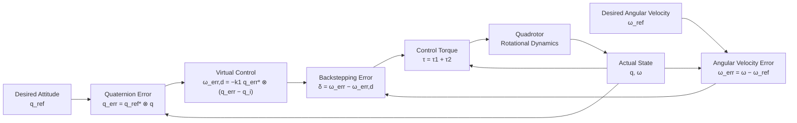

<p align="center">
  
</p>


# Quaternion-Based Attitude Tracking Control for a Quadrotor UAV

## Team Members

| Name | Roll Number |
|---|---|
| N.Supreeth | CB.SC.U4AIE24139 |
| P.Rohit | CB.SC.U4AIE24145 |
| B.Nikhil | CB.SC.U4AIE24063 |
| M.Phanendhra | CB.SC.U4AIE24032 |
| D.Koushik | CB.SC.U4AIE24167 |

---

# Title

## Quaternion-Based Attitude Tracking Control for a Quadrotor UAV

---

# Abstract

Quadrotor UAVs require accurate attitude control to maintain and change their orientation during flight. This project investigates a quaternion-based attitude tracking controller using a backstepping control approach.

Quaternions are used to represent the orientation of the quadrotor because they provide a compact representation of three-dimensional rotations without the singularities associated with Euler angles. The controller uses the difference between the desired and actual quaternion to determine the attitude error and then generates a desired angular velocity through a virtual control law.

A second backstepping stage is used to calculate the required control torque while accounting for the nonlinear rotational dynamics of the quadrotor. A fractional-power feedback term is included to reduce the backstepping error.

The complete controller is implemented and evaluated through numerical simulation in MATLAB. The simulation examines quaternion error, angular velocity tracking error, backstepping error, and control torque.

---

# Introduction

A quadrotor UAV is an underactuated nonlinear system whose motion depends on the interaction between its position, orientation, angular velocity, and control inputs. Among these, attitude control is particularly important because the orientation of the vehicle determines the direction in which the generated thrust acts.

The attitude of a quadrotor can be represented using Euler angles, rotation matrices, or quaternions. Although Euler angles are intuitive, they can suffer from gimbal lock. Quaternions provide an alternative representation that is well suited for describing three-dimensional orientation and nonlinear attitude control.

In this project, the attitude is represented using a unit quaternion:

```math
q = [q_0,\ q_1,\ q_2,\ q_3]^T
```

with the unit-quaternion constraint:

```math
\lVert q\rVert =
\sqrt{q_0^2 + q_1^2 + q_2^2 + q_3^2}
= 1
```

The main objective is to make the actual quadrotor attitude follow a desired attitude trajectory while ensuring that the angular velocity tracking error is reduced.

The control strategy is based on backstepping. Since torque directly affects angular velocity and angular velocity determines the evolution of the attitude, the controller is developed in stages. The first stage generates a desired angular velocity from the quaternion attitude error. The second stage determines the control torque required to make the actual angular velocity follow this desired behaviour.

This project is based on the research paper **"Quaternion-Based Attitude Tracking Control Design for UAVs"** by Qain-Rong Lin and Jen-te Yu, presented at the 2024 International Automatic Control Conference (CACS 2024).

---

# Methodology

## 1. Quaternion Representation

The quadrotor attitude is represented by a unit quaternion:

```math
q = [q_0,\ q_1,\ q_2,\ q_3]^T
```

The quaternion conjugate is given by:

```math
q^* =
[q_0,\ -q_1,\ -q_2,\ -q_3]^T
```

For a unit quaternion, the inverse is equal to its conjugate:

```math
q^{-1} = q^*
```

During numerical simulation, quaternion normalization is applied to maintain the unit-quaternion constraint:

```math
q_{\mathrm{norm}} =
\frac{q}{\lVert q\rVert}
```

---

## 2. Quaternion Multiplication

The multiplication of two quaternions is written as:

```math
q_1 \otimes q_2
```

For:

```math
q_1 = [a,\ b,\ c,\ d]^T
```

and:

```math
q_2 = [e,\ f,\ g,\ h]^T
```

their product is:

```math
q_1 \otimes q_2 =
\begin{bmatrix}
ae-bf-cg-dh \\
af+be+ch-dg \\
ag-bh+ce+df \\
ah+bg-cf+de
\end{bmatrix}
```

Quaternion multiplication is non-commutative:

```math
q_1 \otimes q_2 \neq q_2 \otimes q_1
```

Therefore, the order of multiplication is important when calculating the attitude error.

---

## 3. Quadrotor Attitude Dynamics

The attitude evolution is described using quaternion kinematics:

```math
\dot{q}
=
\frac{1}{2}
q \otimes
\begin{bmatrix}
0 \\
\omega
\end{bmatrix}
```

where $q$ represents the current attitude quaternion and $\omega$ represents the angular velocity.

The rotational dynamics of the quadrotor are described by:

```math
\dot{\omega}
=
J^{-1}
\left[
\tau-\omega\times(J\omega)
\right]
```

where:

- $J$ is the inertia matrix.
- $\omega$ is the angular velocity.
- $\tau$ is the applied control torque.
- $\omega\times(J\omega)$ represents the gyroscopic term.

These two equations form the rotational model used in the closed-loop simulation.

---

## 4. Quaternion Attitude Error

The desired attitude is represented by the reference quaternion $q_{\mathrm{ref}}$.

The quaternion tracking error is calculated as:

```math
q_{\mathrm{err}}
=
q_{\mathrm{ref}}^*
\otimes q
```

When the actual and desired attitudes are identical:

```math
q = q_{\mathrm{ref}}
```

the error becomes the identity quaternion:

```math
q_{\mathrm{err}}
=
[1,\ 0,\ 0,\ 0]^T
```

Therefore, the controller aims to drive the quaternion error toward the identity quaternion.

---

## 5. Angular Velocity Error

The angular velocity tracking error is defined as:

```math
\omega_{\mathrm{err}}
=
\omega-\omega_{\mathrm{ref}}
```

where $\omega_{\mathrm{ref}}$ is the desired angular velocity.

The desired tracking condition is:

```math
\omega_{\mathrm{err}}
\rightarrow 0
```

---

## 6. Quaternion Error Dynamics

The quaternion error dynamics connect the attitude error with the angular velocity error:

```math
\dot{q}_{\mathrm{err}}
=
\frac{1}{2}
q_{\mathrm{err}}
\otimes
\begin{bmatrix}
0 \\
\omega_{\mathrm{err}}
\end{bmatrix}
```

This relationship provides the basis for the first stage of the backstepping controller.

---

## 7. Desired angular velocity error

The virtual control is defined by:

```math
\begin{bmatrix}
0 \\
\omega_{\mathrm{err},d}
\end{bmatrix}
=
-k_1
q_{\mathrm{err}}^*
\otimes
(q_{\mathrm{err}}-q_i)
```

where:

```math
q_i =
[1,\ 0,\ 0,\ 0]^T
```

and $k_1>0$ is the first control gain.

The purpose of this virtual control is to drive the quaternion error toward the identity quaternion.

The resulting desired quaternion error behaviour is:

```math
\dot{q}_{\mathrm{err}}
=
-\frac{k_1}{2}
(q_{\mathrm{err}}-q_i)
```

---


---

## 8. Backstepping Controller

The controller is developed in two stages.

The first stage uses the quaternion attitude error to generate a desired angular velocity error. The second stage uses the difference between the actual and desired angular velocity errors to calculate the required control torque.

The backstepping error is defined as:

```math
\delta
=
\omega_{\mathrm{err}}
-
\omega_{\mathrm{err},d}
```

where $\omega_{\mathrm{err},d}$ is the desired angular velocity error 

---

## 9. Backstepping Error Dynamics

The backstepping error is:

```math
\delta
=
\omega_{\mathrm{err}}
-
\omega_{\mathrm{err},d}
```
The quaternion error dynamics are:

```math
\begin{aligned}
\dot q_{\mathrm{err}}
&= -\frac{k_1}{2}(q_{\mathrm{err}}-q_i)
+ \frac{1}{2}q_{\mathrm{err}}\otimes
\begin{bmatrix}0\\\delta\end{bmatrix}
\end{aligned}
```


Differentiating gives:

```math
\dot{\delta}
=
\dot{\omega}_{\mathrm{err}}
-
\dot{\omega}_{\mathrm{err},d}
```

Since:

```math
\omega_{\mathrm{err}}
=
\omega-\omega_{\mathrm{ref}}
```

we obtain:

```math
\dot{\omega}_{\mathrm{err}}
=
\dot{\omega}
-
\dot{\omega}_{\mathrm{ref}}
```

Using the rotational dynamics:

```math
\dot{\omega}
=
J^{-1}
\left[
\tau-\omega\times(J\omega)
\right]
```

the backstepping error dynamics become:

```math
\dot{\delta}
=
J^{-1}
\left[
\tau-\omega\times(J\omega)
\right]
-
\dot{\omega}_{\mathrm{ref}}
-
\dot{\omega}_{\mathrm{err},d}
```

---

## 10. Control Torque

The control torque is divided into a dynamics compensation component and an error convergence component:

```math
\tau=\tau_1+\tau_2
```

The first component compensates for the nonlinear rotational dynamics and reference motion:

```math
\tau_1
=
\omega\times(J\omega)
+
J\dot{\omega}_{\mathrm{ref}}
+
J\dot{\omega}_{\mathrm{err},d}
```

The second component provides error convergence:

```math
\tau_2
=
-k_2J\delta^{1/3}
```

where $k_2>0$.

Combining the two components gives the final control law:

```math
\tau
=
\omega\times(J\omega)
+
J\dot{\omega}_{\mathrm{ref}}
+
J\dot{\omega}_{\mathrm{err},d}
-
k_2J\delta^{1/3}
```

The resulting backstepping error dynamics are:

```math
\dot{\delta}
=
-k_2\delta^{1/3}
```

The control law therefore works to reduce the backstepping error while compensating for the nonlinear rotational dynamics.

---

## 11. Reference Trajectory

The reference angular velocity consists of three signals.

It is represented as:

```math
\omega_{\mathrm{ref}}
=
\begin{bmatrix}
\omega_{\mathrm{ref},1} \\
\omega_{\mathrm{ref},2} \\
\omega_{\mathrm{ref},3}
\end{bmatrix}
```

and its derivative is:

```math
\dot{\omega}_{\mathrm{ref}}
=
\frac{d\omega_{\mathrm{ref}}}{dt}
```
The reference trajectory provides the desired motion that the controller attempts to track.

---
## 12. UAV 3D Simulation & Control Environment

An interactive 3D WebGL environment designed to validate the **Quaternion-Based Backstepping Controller** under realistic wind, turbulence, and obstacle conditions.
---
### 12.1 Quadrotor Physical Modeling & Dynamics
Modeled as a rigid body with 4 rotors in an 'X' frame:
| Parameter | Value | Description |
| :--- | :--- | :--- |
| **Total Mass ($m$)** | `1.2 kg` | Frame, battery, and avionics |
| **Inertia Matrix ($J$)** | `diag(0.1, 0.1, 0.12) kg·m²` | Rotational resistance (X, Y, Z) |
| **Arm Length ($L$)** | `0.225 m` (22.5 cm) | Center of gravity to motor hub |
| **Control Rate** | `200 Hz` ($\Delta t = 5\text{ ms}$) | High-frequency attitude loop |
| **Gravity ($g$)** | `9.81 m/s²` | Standard downward gravity |
| **Max Tilt Angle** | `35°` | Safety limit to prevent tumbling |
* **Collective Thrust ($T$):** Total upward force along body $Z$-axis ($\approx 11.8\text{ N}$ to hover).
* **Control Torques ($\boldsymbol{\tau}$):** Roll ($\tau_x$), pitch ($\tau_y$), and yaw ($\tau_z$) torques in $\text{N}\cdot\text{m}$ computed by the quaternion controller.
---
### 12.2 Trajectory Planning & Reactive Obstacle Avoidance
* **Straight Reference Corridor:** Direct straight lines connecting waypoints (`Start → WP1 → WP2 → ...`).
* **How Obstacle Avoidance Works:**
  * **Normal Vector ($\hat{n}_{\text{lat}}$):** Computes a $90^\circ$ sideways horizontal vector perpendicular to the flight path.
  * **Smooth Evasion Polynomial:** Uses a $C^2$-continuous bell-curve function:
    $$P(s) = 64 \cdot s^3 \cdot (1 - s)^3$$
  * **Safe Clearance:** Smoothly pushes the drone **$1.15\text{ m}$ to the side** at the midpoint,clearing the $0.45\text{ m}$ tower with a $>0.70\text{ m}$ safety margin.
  * **Automatic Re-convergence:** Once past the obstacle, the drone merges **straight back onto the reference line**.
* **Why This Approach:** Clearly proves active collision avoidance by showing the drone deviate from the straight mission line and return.
---
### 12.3 Real-World Wind & Disturbance Model
Injected directly into the 6-DOF physics equations to simulate real outdoor flight:
* **What Noise is Used:**
  * **Steady Crosswind:** Constant breeze vector (`[1.5, -1.1, 0.3] m/s`) causing continuous aerodynamic drag.
  * **Wind Gusts:** Multi-frequency sinusoidal gusts ($0.8\text{ Hz}$, $1.4\text{ Hz}$, $2.2\text{ Hz}$) with amplitudes up to $2.2\text{ m/s}$.
  * **Air Turbulence & Propeller Wake:** Random force noise ($\sigma = 0.56\text{ N}$) and rotor torque noise ($\sigma = 0.05\text{ N}\cdot\text{m}$).
* **Tuning:** Adjustable via `--noise-factor` (e.g. `0.0` for zero noise, `0.5` for mild breeze, `2.0` for heavy storm).
---
### 12.4 Real-Time Telemetry Dashboard (HUD)
A live telemetry panel on the right side of the screen displaying:
* **Flight Time & Target:** Mission clock and active target waypoint index.
* **Tracking Error ($\|e_p\|$):** Distance between the drone and the straight line (shows clearance while dodging).
* **Attitude (RPY):** Real-time Roll, Pitch, and Yaw tilt angles in degrees.
* **Actuators:** Total motor thrust ($T$) in Newtons and torques ($\tau_x, \tau_y, \tau_z$) in $\text{N}\cdot\text{m}$.
* **Control States:** Internal backstepping error states ($z_1, z_2$) verifying closed-loop stability.

---
## 13. PyBullet 3D Simulation Environment

To validate the theoretical quaternion backstepping controller on realistic 6-DOF flight dynamics beyond ideal mathematical equations, a high-fidelity 3D simulation environment was developed using the **PyBullet physics engine**.


### 13.1 Quadrotor Physical Modeling & Rigid-Body Dynamics

| Physical Parameter | Value | Description |
|---|---:|---|
| Total Mass ($m$) | $1.0\,\text{kg}$ | Quadrotor airframe & payload mass |
| Inertia Matrix ($J$) | $\text{diag}(0.1,\ 0.1,\ 0.12)\,\text{kg}\cdot\text{m}^2$ | Principal moments of inertia |
| Arm Length ($L$) | $0.22\,\text{m}$ | Motor center to center-of-gravity distance |
| Physics Timestep ($\Delta t$) | $1/240\,\text{s}\ (4.167\,\text{ms})$ | High-frequency symplectic integrator step |
| Gravitational Acceleration ($g$) | $9.81\,\text{m/s}^2$ | Earth standard gravity along $-\hat{\mathbf{z}}_W$ |

The environment applies body-frame forces and torques:

1. **Total Collective Thrust ($T$)**: Applied along the vehicle's body $Z$-axis ($\mathbf{z}_B$).
2. **Control Torques ($\boldsymbol{\tau}$)**: Applied as three-axis body torques $[\tau_x,\ \tau_y,\ \tau_z]^T$ calculated directly by the quaternion backstepping controller.

---

### 13.2 Cascaded 3D Position Control & Trajectory Planning

#### 13.2.1 Outer-Loop SE(3) Position Controller
The desired acceleration is computed using the following equation:

$$\begin{aligned} \mathbf{a}_{\text{des}} &= \mathbf{a}_d + \mathbf{K}_p(\mathbf{p}_d - \mathbf{p}) + \mathbf{K}_d(\mathbf{v}_d - \mathbf{v}) \\ &\quad + \mathbf{K}_i \int (\mathbf{p}_d - \mathbf{p})\,dt \\ &\quad + \mathbf{f}_{\text{rep}} + g\hat{\mathbf{z}}_{W} \end{aligned}$$

**Where:**
- $\mathbf{p}_d, \mathbf{p}$: Desired and actual positions.
- $\mathbf{v}_d, \mathbf{v}$: Desired and actual velocities.
- $\mathbf{a}_d$: Desired acceleration feedforward.
- $\mathbf{K}_p, \mathbf{K}_d, \mathbf{K}_i$: PID controller gains.
- $\mathbf{f}_{\text{rep}}$: Obstacle avoidance force.
- $g$: Gravitational acceleration ($9.81\ \text{m/s}^2$).
- $\hat{\mathbf{z}}_W$: World-frame vertical unit vector, $[0,0,1]^T$.

#### 13.2.2 Thrust and Attitude Extraction
The desired body-frame $z$-axis is calculated as:

$$\mathbf{z}_{B,\text{des}} = \frac{\mathbf{a}_{\text{des}}}{\Vert{}\mathbf{a}_{\text{des}}\Vert{}}$$

The collective thrust is computed as:

$$T = m(\mathbf{a}_{\text{des}} \cdot \mathbf{z}_B)$$

The resulting reference quaternion, $\mathbf{q}_{\text{ref}}$, and collective thrust, $T$, are supplied to the inner-loop attitude controller.

#### 13.2.3 Quintic Polynomial Trajectory Generation
A fifth-order polynomial trajectory generator provides:
- $C^2$-continuous motion profiles.
- Smooth position, velocity, and acceleration profiles.
- Rest-to-rest waypoint transitions.
- Smooth trajectory stitching between consecutive waypoints.

#### 13.2.4 Altitude Protection and Tilt Limiting

| Safety Constraint | Value |
|---|---|
| Minimum vertical acceleration | $a_z \geq 3.0\ \text{m/s}^2$ |
| Maximum tilt angle | $\theta_{\max} = 45^\circ$ |

---

### 13.3 Real-Time Forward LiDAR Perception & Obstacle Avoidance

#### 13.3.1 Onboard Virtual LiDAR
To simulate autonomous navigation in unmapped environments without prior obstacle coordinates:
- An onboard virtual LiDAR scanner is mounted to the quadrotor frame using PyBullet ray casting (`p.rayTestBatch`).
- The sensor scans the forward flight direction to detect obstacles in the quadrotor's path.

| Parameter | Value |
|---|---:|
| Horizontal rays | 15 |
| Field of View (FOV) | $100^\circ$ |
| Maximum range | 2.5 m |
| Target update rate | 240 Hz |

#### 13.3.2 Reactive Artificial Potential Field (APF)
When an obstacle intersects the detection beam, the sensor measures the obstacle's relative distance $d$ and evasion direction vector $\hat{\mathbf{n}}_{\text{evade}}$, injecting a repulsive force into the outer-loop position controller:

$$\mathbf{f}_{\text{rep}} = k_{\text{rep}} \frac{d_{\text{safe}}-d}{d+\epsilon} \hat{\mathbf{n}}_{\text{evade}}$$

**Where:**
- $k_{\text{rep}}$: Repulsion gain.
- $d_{\text{safe}}$: Required safety distance.
- $d$: Measured distance to the obstacle.
- $\epsilon$: Small numerical protection constant.
- $\hat{\mathbf{n}}_{\text{evade}}$: Unit vector indicating the avoidance direction.

#### 13.3.3 Dynamic Pop-Up Obstacle Replanning
When an unmapped obstacle appears during flight:
1. Detect the obstacle using the virtual LiDAR.
2. Compute a suitable avoidance direction.
3. Update the trajectory boundary conditions.
4. Regenerate a smooth trajectory around the obstacle ($C^1$ or $C^2$ continuity).
5. Continue tracking the updated path.

---

### 13.4 Telemetry, Visualizations & Data Logging

#### 13.4.1 Real-Time Desktop Telemetry Dashboard (HUD)
A dedicated, non-blocking desktop graphical HUD (built with Tkinter) runs alongside the 3D PyBullet viewport to display live state telemetry:
- **Mission Progress**: Elapsed simulation time and active target waypoint index.
- **Tracking Errors**: 3D Euclidean position error $\lVert \mathbf{e}_p \rVert$ and axis breakdown $[e_x, e_y, e_z]$.
- **Attitude States**: Actual vs. desired Euler angles (Roll, Pitch, Yaw) and quaternion error vector $\mathbf{q}_{\text{err}}$.
- **Actuator Outputs**: Total collective thrust ($T$) in Newtons and body torques $[\tau_x, \tau_y, \tau_z]$ in $\text{N}\cdot\text{m}$.
- **Perception Status**: Live radar alerts upon obstacle detection and active Gaussian sensor noise level ($\sigma$).

#### 13.4.2 Flight Corridor & Trail Rendering
- **3D Waypoint Markers**: Spherical beacons indicating start (green), intermediate guides (amber), and destination (red).
- **Trajectory Path**: Real-time 3D debug lines showing the analytical quintic reference path.
- **Flight Trail**: A continuous cyan ribbon tracing actual physical flight path to visually verify tracking accuracy and avoidance clearance.

#### 13.4.3 Automatic Simulation Outputs

| Output File | Description |
|---|---|
| `uav_3d_flight_trajectory.png` | 3D flight trajectory and spatial tracking performance. |
| `uav_paper_metrics_reproduction.png` | Telemetry plots reproducing the paper's benchmark evaluation metrics. |
| `flight_coordinates.csv` | Timestamped reference vs. actual flight coordinates. |

---

### 13.5 Standalone Benchmark Execution

The standalone benchmark evaluates the quaternion-based attitude controller independently of the outer-loop position controller. This isolates and validates the attitude controller's tracking performance, convergence rates, and stability limits without interference from external trajectory planning or obstacle avoidance modules.
## 14. UAV 3D Simulation & Control Environment

To test our **Quaternion-Based Backstepping Controller** on realistic 6-DOF (Degrees-of-Freedom) flight dynamics, we developed a full physics-based simulation and an interactive 3D WebGL environment. It simulates real flight conditions—including wind disturbances and obstacle avoidance.

---


## **14. MuJoCo 3D Simulation Environment**

To test the **quaternion backstepping attitude controller** on a realistic 6-DOF drone, a 3D simulation was developed using **MuJoCo** with a live visual dashboard.

---

### **14.1 Drone Model & Physics Parameters**

The quadrotor is modeled as a 6-DOF rigid body with collision shapes representing the chassis, four arms, and rotors.

| Parameter | Value | Description |
| :--- | :--- | :--- |
| **Mass (`m`)** | `1.0 kg` | Total drone mass |
| **Inertia (`J`)** | `diag(0.10, 0.10, 0.12) kg·m²` | Moment of inertia matrix |
| **Arm Length (`L`)** | `0.85 m` | Distance from the center to each motor |
| **Physics Time Step (`Δt`)** | `0.002 s (500 Hz)` | Physics simulation timestep |
| **Gravity (`g`)** | `9.81 m/s²` | Gravitational acceleration |

---

### **14.2 Obstacle Avoidance System**

The drone is designed to detect obstacles and navigate around them while moving between waypoints.
- **3-Step Detour Path:**
  1. **Pre-Apex:** The drone begins changing direction before reaching an obstacle.
  2. **Apex:** The drone moves around the obstacle while maintaining a planned safety clearance of `2.2 m` to `2.8 m`.
  3. **Exit:** After clearing the obstacle, the drone returns toward its original route.

- **Obstacle Repulsion:** When the drone comes within `1.5 m` of an obstacle, an automatic repulsion mechanism steers it away to reduce the risk of collision.

---

### **14.3 Live Dashboard (HUD)**

The dashboard displays important information while the simulation runs.

- **Flight Progress:** Simulation time, current waypoint (WP1 → WP2 → WP3 → Destination), and a "Destination Reached" alert.
- **Position Error & RMSE:** Distance between the drone and its target, along with overall position-tracking accuracy.
- **Angles & Orientation:** Real-time roll, pitch, yaw angles, and quaternion error.
- **Control Commands:** Total thrust (`T`) in newtons and control torques (`τx`, `τy`, `τz`) in `N·m`.
- **Obstacle Status:** Avoidance state (`CLEAR` or `AVOIDING`), nearest obstacle distance, and collision counter.
- **Camera Views:** Flight Path, Chase (Follow), Overview, and Top-Down views.

---

### **14.4 Trajectory & Visual Markers**

The simulation uses visual markers to represent the route, waypoints, obstacles, and actual drone movement.

### **Waypoint Markers**

1. **Start (WP0):** Blue marker at `[0, 0, 1] m`.
2. **Intermediate Waypoints (WP1, WP2, WP3):** Orange markers indicating intermediate targets.
3. **Destination:** Green marker at `[14, 12, 5] m`.
4. **Physical Obstacles:** 3D shapes representing a cylindrical pillar, box tower, sphere, and tall pylon.
5. **Orange Dashed Line:** Represents the original planned route between waypoints.
6. **Solid Blue Line:** Represents the actual flight path traveled by the drone.

   ____

8. ### 15.1 UAV Simulation & Physical Environment

The quadrotor is simulated using **ArduPilot SITL and Gazebo Harmonic**, with Python handling telemetry, trajectory planning, and mathematical calculations.

- **Simulation Platform:** ArduPilot SITL + Gazebo Harmonic.
- **Communication:** MAVLink using pymavlink.
- **Trajectory:** A → B → C → D → A.
- **Attitude Representation:** Quaternion-based orientation.
- **Flight Control:** ArduPilot manages the simulated drone's flight.

---

### 15.2 Trajectory Planning & Obstacle Avoidance

The mission uses the **A* star search algorithm** to plan a path around obstacles represented on a Python planning map.

- **Waypoint Navigation:** The drone follows four waypoints in sequence.
- **Obstacle Representation:** Circular obstacles are defined using coordinates and radii.
- **Safety Clearance:** A clearance distance is considered during path planning.
- **Path Optimization:** A* searches the grid for a feasible route while avoiding blocked regions.

*Note: Physical obstacle avoidance requires corresponding obstacles in Gazebo and suitable sensor-based detection.*

---

### 15.3 Sensor Noise Simulation

Gaussian noise is added to copies of the sensor readings to demonstrate measurement uncertainty.

- **Position Noise:** Standard deviation of `0.15 m`.
- **Velocity Noise:** Standard deviation of `0.08 m/s`.
- **Quaternion Noise:** Standard deviation of `0.025` per component.
- **Noisy Measurements:** True and noisy readings are displayed for comparison.
- **Noise Recovery:** Filtering and noise-recovery algorithms are not implemented.

---

### 15.4 Real-Time Telemetry & Control Dashboard

The Python dashboard displays live telemetry and mathematical calculations during the simulation.

- **Position & Velocity:** Current UAV position and velocity.
- **Quaternion:** Orientation and quaternion components.
- **Attitude Errors:** Quaternion error and angular-velocity error.
- **Trajectory Visualization:** Current position, waypoints, and planned obstacle-avoiding path.
- **Noise Comparison:** True sensor readings, generated noise, and noisy measurements.

## Results

<p align="center">
  
</p>

<p align="center">
  
</p>


_____


# Results

The closed-loop simulation evaluates the attitude tracking and controller performance using quaternion error, angular velocity error, backstepping error, and control torque.

The controller is expected to drive the quaternion error toward the identity quaternion:

```math
q_{\mathrm{err}}
\rightarrow
[1,\ 0,\ 0,\ 0]^T
```

The angular velocity tracking error is expected to approach zero:

```math
\omega_{\mathrm{err}}
\rightarrow
[0,\ 0,\ 0]^T
```

The backstepping error is expected to converge toward zero:

```math
\delta
\rightarrow
[0,\ 0,\ 0]^T
```

The control torque should decrease as the system approaches the desired trajectory.

According to the results reported in the research paper, the angular velocity error approaches zero at approximately **0.8 seconds**, while the backstepping error approaches zero at approximately **0.4 seconds**. The reported results also show convergence of the quaternion error toward the identity quaternion and reduction of the control torque as the system reaches the desired behaviour.

The simulation therefore provides a way to evaluate how effectively the quaternion-based backstepping controller tracks the prescribed attitude trajectory.


---

# Conclusion

This project presents a quaternion-based backstepping controller for attitude tracking of a quadrotor UAV.

The quadrotor rotational motion is modelled using quaternion kinematics and nonlinear rotational dynamics. Quaternion error is used to measure the difference between the actual and desired attitudes, while angular velocity error is used to measure the difference in rotational motion.

The controller uses a two-stage backstepping approach. First, a virtual control generates the desired angular velocity error from the quaternion error. The second stage calculates the required control torque using the backstepping error, nonlinear dynamics compensation, reference motion, and a fractional-power feedback term.

The final control law is:

```math
\tau
=
\omega\times(J\omega)
+
J\dot{\omega}_{\mathrm{ref}}
+
J\dot{\omega}_{\mathrm{err},d}
-
k_2J\delta^{1/3}
```

with:

```math
\delta
=
\omega_{\mathrm{err}}
-
\omega_{\mathrm{err},d}
```

The simulation results demonstrate the expected convergence of the tracking errors and provide a basis for evaluating the controller's performance.

---



# Research Paper

**Quaternion-Based Attitude Tracking Control Design for UAVs**

**Authors:** Qain-Rong Lin and Jen-te Yu

**Conference:** 2024 International Automatic Control Conference (CACS 2024)

**Location:** National Taiwan University of Science and Technology, Taipei

**Date:** November 1–3, 2024

**DOI:** 10.1109/CACS63404.2024.10773309
